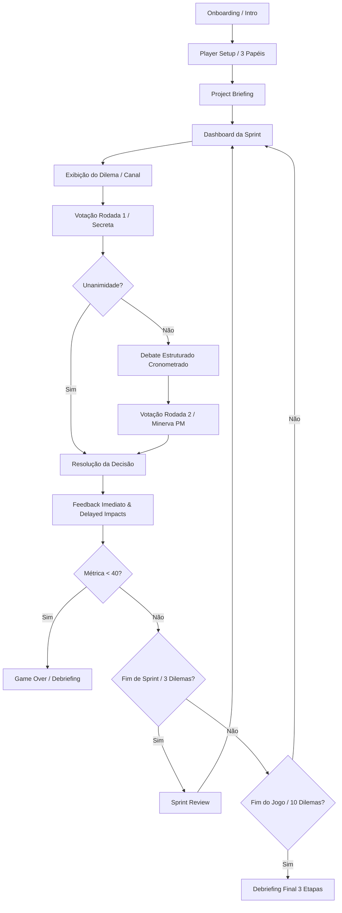

# Proposta de Adaptação do Hard Work Manager: Transição para o Domínio de Recursos (PMBOK 8)

---

## 1. Resumo Executivo

O Hard Work Manager é um *serious game* colaborativo (React 19, TypeScript, Zustand) desenvolvido para TCC na UFC, atualmente fundamentado no domínio "Trabalho do Projeto" do PMBOK 7. Com o lançamento do PMBOK 8 e a extinção desse domínio, propõe-se adaptar o jogo para o domínio de **Recursos**, preservando integralmente suas mecânicas centrais (4 métricas, hotseat de 3 papéis, votação/debate, impactos diferidos e baralho de 10 dilemas em 4 sprints). O estudo revelou que 20 dos 50 dilemas possuem alta aderência direta a Recursos (sobretudo gestão de equipe e infraestrutura), 12 podem ser reescritos e 18 devem ser substituídos por tratarem de escopo, auditoria e requisitos alheios ao domínio. A transição prevê a introdução dos tipos `resourceType` e `resourceProcess`, reformulação dos textos da mentora Helena, do Debriefing e das causas de Game Over, garantindo rigor pedagógico sem descontinuar a persistência do `localStorage`.

---

## 2. Estudo do Domínio Recursos (PMBOK 8)

### 2.1 Definição do Domínio e Tipos de Recursos

Conforme o Guia PMBOK 8 (Seção 2.6) e a fonte secundária (*Escritório de Projetos*), o **Domínio de Desempenho de Recursos** refere-se a:
> *"Como a equipe de projeto planeja e utiliza seus recursos disponíveis de forma eficaz e eficiente. Abrange tanto recursos humanos quanto físicos/virtuais, cobrindo disponibilidade, utilização e manutenção."* (PMBOK 8, Seção 2.6, linhas 2-7 de `scratch_pmbok8_resources.txt`).

O domínio estrutura os recursos em duas categorias fundamentais:

| Tipo de Recurso (`resourceType`) | Definição Oficial (PMBOK 8, Seção 2.6.1) | Exemplos Reais no Contexto SIGAA / UFC |
| :--- | :--- | :--- |
| **Humano** (`humano`) | Indivíduos com papéis e responsabilidades atribuídas que trabalham coletivamente para atingir o objetivo compartilhado do projeto. Requer liderança, motivação, desenvolvimento de competências e inteligência emocional. | Desenvolvedores de lógica interna e telas, analistas de testes, designers, Gerente de Projetos, especialistas em banco de dados e arquitetura. |
| **Físico / Virtual** (`fisico_virtual`) | Qualquer recurso que não seja uma pessoa: equipamentos, materiais, instalações, infraestrutura, software, ambientes de teste, licenças, serviços, dados ou informações. | Servidores de aplicação, instâncias em nuvem, bancos de dados legados, ambiente de homologação (*staging*), licenças de software (ex.: Oracle), pipelines de CI/CD, ferramentas de monitoramento. |

---

### 2.2 Os 5 Processos do Domínio de Recursos

O domínio organiza o ciclo de vida dos recursos em cinco processos contínuos ou periódicos (PMBOK 8, Seção 2.6.2):

| # | Processo (`resourceProcess`) | Nome em Inglês | Propósito e Benefício Central (PMBOK 8, Seção 2.6.2) | Foco Principal |
| :-: | :--- | :--- | :--- | :--- |
| **1** | **Planejar o Gerenciamento dos Recursos** | *Plan Resource Management* | Definir a abordagem e o nível de esforço de gestão necessários para estimar, adquirir, liderar e utilizar recursos físicos, virtuais ou de equipe, considerando escassez e concorrência entre projetos. | Abordagem geral, políticas de equipe e capacidade institucional. |
| **2** | **Estimar Recursos** | *Estimate Resources* | Estimar recursos de equipe e o tipo, quantidade e características dos recursos físicos/virtuais necessários para realizar as atividades, antecipando escassez ou excedente. | Quantificação, dimensionamento e perfis de competência. |
| **3** | **Adquirir Recursos** | *Acquire Resources* | Obter e atribuir os recursos de equipe, físicos ou virtuais necessários, negociando com gerentes funcionais/recursos e conduzindo aquisições externas. | Negociação interna, contratação externa e alocação. |
| **4** | **Liderar a Equipe** | *Lead the Team* | Desenvolver competências, aprimorar interações e o ambiente da equipe, fornecer feedback, resolver conflitos e gerenciar mudanças nas pessoas para potencializar o desempenho do projeto. | **Exclusivo para pessoas (Recursos Humanos).** |
| **5** | **Monitorar e Controlar Recursos** | *Monitor and Control Resourcing* | Garantir que recursos físicos ou virtuais estejam disponíveis conforme planejado, monitorando o uso real vs. planejado e tomando ações corretivas contínuas. | **Exclusivo para Recursos Físicos e Virtuais.** |

> **Nota Crítica de Arquitetura Conceitual (PMBOK 8, Seção 2.6.2.5):** O processo *Monitorar e Controlar Recursos* trata estritamente de recursos físicos e virtuais. As pessoas da equipe são geridas e acompanhadas no processo *Liderar a Equipe*. Confundir essa separação levaria o jogo a ensinar uma abordagem mecanicista e incorreta de pessoas como insumos controláveis.

---

### 2.3 Os 7 Resultados Esperados (*Target Outcomes*) e Verificação

O sucesso na gestão de recursos é avaliado pelo atingimento de 7 resultados específicos (PMBOK 8, Seção 2.6.5 e Fonte 2):

| Cód. | Resultado Esperado (*Outcome*) | Descrição Conceitual | Indicador de Verificação (*Check Results*) | Mapeamento no Jogo HWM |
| :-: | :--- | :--- | :--- | :--- |
| **R1** | **Propriedade compartilhada do projeto** | A equipe compreende a visão, objetivos e assume a posse das entregas e resultados. | Membros articulam a visão do projeto e tomam responsabilidade proativa pelas entregas sem esperar ordens. | `conhecimentoOrganizacional` (visão compartilhada, quebra de silos) |
| **R2** | **Equipe de alto desempenho** | Confiança mútua, colaboração aberta, adaptabilidade a mudanças e resiliência diante de falhas. | Avaliações de clima de equipe, ausência de silos de trabalho, comunicação aberta e baixa rotatividade. | `saudeEquipe` (clima, confiança, ausência de burnout) |
| **R3** | **Utilização eficaz de recursos** | O consumo real de recursos versus o planejado é gerenciado com precisão e balanceamento. | Desvios mínimos entre capacidade planejada e alocada; ausência de sobrealocação crônica. | `capacidadeEntrega` (Velocity sustentável, sem gargalos) |
| **R4** | **Percentual aceitável de inatividade** | Minimização de tempo ocioso forçado por bloqueios, esperas burocráticas ou falta de insumos. | Tempo de bloqueio/inatividade de devs e ambientes dentro de limites aceitáveis do projeto. | `capacidadeEntrega` e `saudeEquipe` (eliminação de bloqueios) |
| **R5** | **Equipe produtiva** | Ritmo de entrega de valor compatível com as horas trabalhadas, avaliado por KPIs claros. | Indicadores de velocidade, taxa de vazão (*throughput*) e metas de sprint batidas sem horas extras crônicas. | `capacidadeEntrega` (eficiência do fluxo de valor) |
| **R6** | **Gestão eficiente de recursos físicos/virtuais** | Uso otimizado de infraestrutura e ferramentas, com mínimo desperdício e retrabalho. | Baixa taxa de retrabalho decorrente de falhas de ambiente; infraestrutura dimensionada sem ociosidade cara. | `qualidadeProduto` (redefinida como ausência de retrabalho e eficiência) |
| **R7** | **Gestão de aquisição de recursos conduzida** | Processos de aquisição, pedidos, contratação e liberações executados no prazo e sem rupturas. | Contratos, licenças e contratações de externos disponibilizados no prazo necessário para a equipe. | Métrica de suporte refletida em eventos táticos |

---

### 2.4 Conceitos-Chave e Técnicas por Processo

```
                                 DOMÍNIO DE RECURSOS (PMBOK 8)
                                                │
         ┌──────────────────────────────┬───────┴──────────────────────┬──────────────────────────────┐
         ▼                              ▼                              ▼                              ▼
    PLANEJAR                         ESTIMAR                        ADQUIRIR                       LIDERAR / MONITORAR
• Matriz RAM (RACI)            • Estimativa Bottom-up         • Negociação funcional        [Liderar Equipe - Humanos]
• Análise SWOT de recursos     • Estimativa Análoga           • Alocação matricial          • Team Charter & Normas
• Políticas de escassez        • Estimativa Paramétrica       • Recursos alternativos       • Liderança Servidora & Distribuída
• Tailoring da abordagem       • Análise de alternativas      • Contratação externa         • Prevenção de Burnout & Clima Seguro
• Visão Baseada em Recursos    • Dimensionamento de esforço   • Gestão de compras           [Monitorar/Controlar - Físicos/Virtuais]
                                                              • Acordos de nível de serviço • Revisão de uso planejado vs. real
                                                                                            • Teoria das Restrições (TOC)
                                                                                            • Redução de Retrabalho e Refugo
```

| Processo | Conceitos-Chave (PMBOK 8, Seção 2.6.1 e 2.6.2) | Técnicas e Ferramentas Homologadas |
| :--- | :--- | :--- |
| **Planejar** | Matriz de responsabilidade, autoridade matricial, competição por recursos escassos, cultura da organização. | Matriz RAM (RACI), análise SWOT de capacidade, gestão verde de recursos (*Green HRM*), Visão Baseada em Recursos (RBV). |
| **Estimar** | Variabilidade de esforço, especialização técnica, curva de aprendizado, redundância de infraestrutura. | Estimativa *Bottom-up*, estimativa análoga, estimativa paramétrica, análise de alternativas, ferramentas com IA e COCOMO. |
| **Adquirir** | Gerente funcional vs. Gerente de projetos, poder de influência, contratação temporária, restrições regulatórias. | Negociação e influência, análise de decisão multicritério, contratações e parcerias, alocação de recursos alternativos com análise de risco. |
| **Liderar a Equipe** | Segurança psicológica, visão compartilhada, dinâmicas de equipe, liderança servidora, transparência de vieses. | *Team charter*, reuniões retrospectivas, escuta ativa, inteligência emocional, coaching/mentoria, reconhecimento e recompensas, métodos como *Six Thinking Hats*. |
| **Monitorar e Controlar** | Gargalos de capacidade, subutilização de licenças, saturação de servidores, despesas com nuvem, desperdício de insumos. | Teoria das Restrições (TOC), análise de custo-benefício, análise de tendências, revisões de desempenho, Mapeamento do Fluxo de Valor (VSM), gráficos de controle. |

---

### 2.5 Considerações de Adaptação (*Tailoring*) no Domínio Recursos

De acordo com a Seção 2.6.3 do PMBOK 8, a gestão de recursos deve ser adaptada em função das características do contexto:
1. **Abordagem de Desenvolvimento (Preditiva vs. Adaptativa):** Em projetos preditivos, a alocação de recursos é fixada antecipadamente em cronogramas estritos; em abordagens adaptativas/ágeis, o foco está em equipes multidisciplinares auto-organizadas com perfil em "T" (*generalistas-especialistas*).
2. **Cultura e Maturidade da Equipe:** Equipes seniores demandam autonomia e liderança distribuída; equipes formadas por terceirizados ou profissionais recém-chegados exigem acolhimento estruturado e mentoria constante.
3. **Equipes Virtuais e Distribuídas:** A gestão deve utilizar ferramentas colaborativas para evitar isolamento e perda de confiança mútua.
4. **Ênfase no Bem-Estar e Prevenção de Burnout:** Políticas explícitas para evitar sobrecarga crônica, turnos exaustivos e desengajamento (*quiet quitting*).
5. **Contexto Organizacional e Práticas Lean:** Adoção de manufatura enxuta, *Just-in-Time*, Kaizen e Teoria das Restrições para eliminar tempos ociosos e desperdícios.

---

### 2.6 Interações com Outros Domínios de Desempenho

| Domínio Conexo (PMBOK 8) | Natureza da Interação com Recursos (PMBOK 8, Seção 2.6.4) | Risco de Sobreposição a Evitar no Jogo |
| :--- | :--- | :--- |
| **Partes Interessadas** (*Stakeholders*) | Gerentes funcionais fornecem recursos; expectativas de patrocinadores pressionam a alocação da equipe. | Não transformar o dilema em engajamento político genérico; manter o foco na *obtenção e blindagem do recurso*. |
| **Cronograma** (*Schedule*) | A indisponibilidade de recursos atrasa o caminho crítico; o dimensionamento da equipe define prazos. | Não focar em sequenciamento abstrato de datas; focar no *tempo de inatividade e esforço produtivo*. |
| **Finanças** (*Finance*) | Custos de contratação, licenças de software e infraestrutura de nuvem consomem o orçamento. | Não focar em contabilidade e fluxo de caixa; focar no *custo-benefício da alocação de ferramentas e profissionais*. |
| **Risco** (*Risk*) | Falta de especialistas-chave ou falha de infraestrutura são riscos com impacto direto no projeto. | Manter a tomada de decisão no nível da *mitigação de recursos*, não na análise de riscos genérica. |
| **Governança** (*Governance*) | Comitês de mudança (CCB) e regras institucionais regulam autorizações de contratação e equipamentos. | O jogo não deve ensinar burocracia de conselho universitário, mas como a equipe viabiliza insumos dentro das regras. |

---

### 2.7 Divergências entre as Fontes

| Tópico | Fonte 1 (Doc. "pmbok8" / `pmbok8-recursos.md`) | Fonte 2 (*Escritório de Projetos* - HTML) | Fonte 3 (Texto Oficial PMBOK 8 / `scratch_pmbok8_resources.txt`) | Resolução / Alinhamento Adotado |
| :--- | :--- | :--- | :--- | :--- |
| **Nomenclatura do Tipo Não-Humano** | Usa `fisico_virtual` no código e menciona "tecnológicos" no plano de adaptação. | Usa "Recursos Físicos ou Virtuais". | Usa *"Physical, material, or virtual resources"* (Seção 2.6.1). | **Adotar `fisico_virtual`** no schema do código e "recursos de infraestrutura e ferramentas" nos textos para os jogadores. |
| **Escopo de Monitorar e Controlar** | Afirma que trata apenas de recursos físicos/virtuais e remete pessoas a Liderar a Equipe. | Reproduz: *"Este processo trata de recursos físicos e virtuais; membros são tratados em Liderar"*. | Confirma formalmente: *"The project team members are addressed in the Lead the Team process"* (Seção 2.6.2.5). | **Confirmado.** Monitorar e Controlar no HWM não deve avaliar desempenho pessoal, apenas uso de ferramentas, servidores e desperdício de esforço. |
| **Vocabulário de Conceitos (`pmbokConcept`)** | Define uma lista taxativa e fechada de conceitos permitidos. | Apresenta os conceitos em texto corrido e exemplos práticos. | Apresenta os conceitos distribuídos nas seções 2.6.1 a 2.6.5. | **Adotar a taxonomia estruturada da Fonte 1**, pois garante consistência nos cards e no Debriefing sem dispersão terminológica. |

---

### 2.8 O que NÃO Pertence ao Domínio Recursos (Regras de Exclusão Pedagógica)

Para impedir desvios conceituais e garantir validade acadêmica ao TCC, estabelece-se a seguinte regra de fronteira:

```
                            TESTE DE FRONTEIRA DO DOMÍNIO RECURSOS
                                              │
              A decisão envolve primariamente a aquisição, alocação, capacitação,
                 liderança ou monitoramento de pessoas, ambientes e ferramentas?
                                              │
                        ┌─────────────────────┴─────────────────────┐
                        ▼ SIM                                       ▼ NÃO
             [ Pertence a Recursos ]                      É dívida técnica pura,
             Enquadrar em um dos 5                        especificação de escopo,
             processos e 2 tipos.                         regra de negócio ou auditoria?
                                                                    │
                                                      ┌─────────────┴─────────────┐
                                                      ▼ SIM                       ▼ NÃO
                                                [ FORA DE RECURSOS ]      Avaliar conexão
                                                Reescrever ou substituir. indireta com retrabalho.
```

1. **Dívida Técnica e Refatoração como fim em si:** Pertence à Qualidade Técnica e Entrega. *No jogo:* só pode aparecer se for contextualizada como **causa de retrabalho que esgota a capacidade produtiva da equipe** (R5/R6).
2. **Qualidade Intrínseca de Código e Testes Unitários Puros:** Pertence ao Domínio de Entrega. *No jogo:* testes entram como **ferramentas virtuais e ambientes de validação** cuja indisponibilidade gera ociosidade forçada (R4/R6).
3. **Escopo Funcional e Detalhamento de Requisitos (ex.: regras de IRA, Catraca do RU, Diploma do MEC):** Pertence ao Domínio de Escopo. Deve ser substituído se o dilema for sobre *o que fazer* em vez de *com quais recursos e pessoas fazer*.
4. **Governança Institucional e Políticas Externas Puras (ex.: reuniões de Conselho, compliance LGPD estrito):** Pertence a Governança e Risco.

---

## 3. Estado Atual do Projeto

### 3.1 Mecânica do Jogo (Evidências no Código-Fonte)

A mecânica do Hard Work Manager opera sobre um modelo determinístico por turnos:



1. **Fluxo de Fases:** Definido em [`src/types/index.ts:1-18`](file:///home/samuel/Documentos/UFC/TCC%202/hardworkmanager/src/types/index.ts#L1-L18) através de 16 estados (`GamePhase`). O roteamento e renderização ocorrem em [`src/routes/index.tsx:38-68`](file:///home/samuel/Documentos/UFC/TCC%202/hardworkmanager/src/routes/index.tsx#L38-L68).
2. **Formação do Baralho (`generateMatchDeck`):** Em [`src/lib/gameLogic.ts:118-147`](file:///home/samuel/Documentos/UFC/TCC%202/hardworkmanager/src/lib/gameLogic.ts#L118-L147), a função sorteia aleatoriamente 2 dilemas de cada um dos 5 arquivos existentes, compondo um baralho fixo de 10 dilemas por partida (Sprint 1: 3, Sprint 2: 3, Sprint 3: 3, Sprint 4: 1).
3. **Votação e Desempate (Voto de Minerva):** A votação da 1ª rodada é individual e secreta ([`src/store/gameStore.ts:190-202`](file:///home/samuel/Documentos/UFC/TCC%202/hardworkmanager/src/store/gameStore.ts#L190-L202)). Se houver divergência, ocorre o debate ([`src/components/screens/DebateStructured.tsx`](file:///home/samuel/Documentos/UFC/TCC%202/hardworkmanager/src/components/screens/DebateStructured.tsx)) seguido da 2ª rodada. Em caso de novo empate, o Gerente de Projetos (`pm`) decide pelo voto de Minerva ([`src/store/gameStore.ts:234-240`](file:///home/samuel/Documentos/UFC/TCC%202/hardworkmanager/src/store/gameStore.ts#L234-L240)).
4. **Métricas e Limites:** 4 métricas com valores iniciais: `capacidadeEntrega` (100), `qualidadeProduto` (100), `saudeEquipe` (100) e `conhecimentoOrganizacional` (50) ([`src/lib/gameLogic.ts:8-13`](file:///home/samuel/Documentos/UFC/TCC%202/hardworkmanager/src/lib/gameLogic.ts#L8-L13)). Todos os valores são limitados entre 0 e 100 via `clamp` ([`src/lib/gameLogic.ts:15-17`](file:///home/samuel/Documentos/UFC/TCC%202/hardworkmanager/src/lib/gameLogic.ts#L15-L17)).
5. **Regra de Interdependência:** Implementada em [`src/lib/gameLogic.ts:20-26`](file:///home/samuel/Documentos/UFC/TCC%202/hardworkmanager/src/lib/gameLogic.ts#L20-L26): se `conhecimentoOrganizacional < 20` e o impacto atual reduzir `capacidadeEntrega`, a perda em capacidade é dobrada (`capacidadeImpact *= 2`).
6. **Impactos Imediatos e Diferidos (*Delayed Impacts*):** O processamento de impactos ocorre em [`src/store/gameStore.ts:244-282`](file:///home/samuel/Documentos/UFC/TCC%202/hardworkmanager/src/store/gameStore.ts#L244-L282). Contadores regressivos (`triggerAfterEvents`) e checagem condicional com `evaluateCondition` ([`src/lib/gameLogic.ts:91-111`](file:///home/samuel/Documentos/UFC/TCC%202/hardworkmanager/src/lib/gameLogic.ts#L91-L111)) disparam consequências diferidas em rodadas posteriores.
7. **Condições de Game Over e Vitória:** Em [`src/lib/gameLogic.ts:44-63`](file:///home/samuel/Documentos/UFC/TCC%202/hardworkmanager/src/lib/gameLogic.ts#L44-L63), o jogo encerra imediatamente se `capacidadeEntrega < 40`, `qualidadeProduto < 40` ou `saudeEquipe < 40`. `conhecimentoOrganizacional` não encerra o jogo diretamente. A vitória é atingida ao concluir os 10 dilemas com todas as 3 métricas críticas $\ge 40$.
8. **Persistência de Dados:** Salva no `localStorage` do navegador sob a chave `'hardwork-manager-storage'` através do middleware `persist` do Zustand ([`src/store/gameStore.ts:135, 366`](file:///home/samuel/Documentos/UFC/TCC%202/hardworkmanager/src/store/gameStore.ts#L135-L366)).

---

### 3.2 O Conteúdo dos 50 Dilemas Atuais

O catálogo atual é composto por 50 dilemas distribuídos em 5 arquivos (`src/data/events/`):

| Arquivo de Eventos | Quantidade | Foco Pedagógico Original (PMBOK 7) | Distribuição de Papéis (`responsibleRole`) |
| :--- | :-: | :--- | :--- |
| `tailoringEvents.ts` | 10 | Adaptação contínua de processos e eliminação de burocracia | `techLead`: 5, `pm`: 4, `uxLead`: 1 |
| `leadershipEvents.ts` | 10 | Comportamentos de liderança e gestão de pessoas | `pm`: 7, `techLead`: 3, `uxLead`: 0 |
| `systemsThinkingEvents.ts` | 10 | Pensamento sistêmico, infraestrutura e legados | `techLead`: 8, `pm`: 1, `uxLead`: 1 |
| `changeManagementEvents.ts` | 10 | Resposta a mudanças regulatórias e de stakeholders | `pm`: 5, `uxLead`: 3, `techLead`: 2 |
| `qualityEvents.ts` | 10 | Qualidade técnica, débito técnico e testes | `techLead`: 9, `uxLead`: 1, `pm`: 0 |
| **Total do Catálogo** | **50** | **Domínio Trabalho do Projeto (PMBOK 7)** | **`techLead`: 25 (50%), `pm`: 18 (36%), `uxLead`: 7 (14%)** |

*Métricas de texto do catálogo:*
- Tamanho das descrições (`description`): média de 220 caracteres (mínimo de 180 e máximo de 300).
- Tamanho dos textos de alternativas (`text`): média de 106 caracteres (mínimo de 80 e máximo de 166).

---

### 3.3 Mapeamento de Presença do PMBOK 7 / "Trabalho do Projeto"

O levantamento realizado identificou resíduos do PMBOK 7 e de "Trabalho do Projeto" em 9 arquivos do código-fonte:

| Arquivo | Linhas | Trecho Encontrado |
| :--- | :--- | :--- |
| [`src/routes/index.tsx`](file:///home/samuel/Documentos/UFC/TCC%202/hardworkmanager/src/routes/index.tsx#L23) | 23, 28 | `'...ensino do domínio Trabalho do Projeto do PMBOK 7.'` |
| [`src/routes/__root.tsx`](file:///home/samuel/Documentos/UFC/TCC%202/hardworkmanager/src/routes/__root.tsx#L82) | 82, 85, 90 | `'Simulador Colaborativo de Gerenciamento de Projetos - PMBOK 7'` |
| [`src/components/screens/Onboarding.tsx`](file:///home/samuel/Documentos/UFC/TCC%202/hardworkmanager/src/components/screens/Onboarding.tsx#L39) | 39, 63, 70, 90 | Fala de Helena: *"Vou guiar vocês pelos desafios do Domínio Trabalho do Projeto (PMBOK 7)"*; *"2 de cada princípio do PMBOK 7"*. |
| [`src/components/screens/PlayerSetup.tsx`](file:///home/samuel/Documentos/UFC/TCC%202/hardworkmanager/src/components/screens/PlayerSetup.tsx#L76) | 76 | Subtítulo: *"Simulador do domínio Trabalho do Projeto do PMBOK 7ª Edição"*. |
| [`src/components/screens/ConsequenceFeedback.tsx`](file:///home/samuel/Documentos/UFC/TCC%202/hardworkmanager/src/components/screens/ConsequenceFeedback.tsx#L252) | 224, 252 | *"Conceito PMBOK 7 em Destaque"*; *"Princípio PMBOK 7 em Prática"*. |
| [`src/components/screens/DebriefingFinal.tsx`](file:///home/samuel/Documentos/UFC/TCC%202/hardworkmanager/src/components/screens/DebriefingFinal.tsx#L63) | 63, 215, 235, 241, 314-315 | *"Conceitos PMBOK 7 Aprendidos"*; *"Domínio de Desempenho Trabalho do Projeto (PMBOK 7)"*. |
| [`src/lib/gameLogic.ts`](file:///home/samuel/Documentos/UFC/TCC%202/hardworkmanager/src/lib/gameLogic.ts#L61) | 61, 115 | Linha 61: *"...paralisando o trabalho do projeto"*; Linha 115: *"5 princípios do PMBOK 7 (Domínio Trabalho do Projeto)"*. |
| [`src/data/dynamicEvents.ts`](file:///home/samuel/Documentos/UFC/TCC%202/hardworkmanager/src/data/dynamicEvents.ts#L10) | 10 | Comentário: *"10 Dilemas por Princípio do PMBOK 7 (Domínio Trabalho do Projeto)"*. |
| [`src/data/events/tailoringEvents.ts`](file:///home/samuel/Documentos/UFC/TCC%202/hardworkmanager/src/data/events/tailoringEvents.ts#L147) | 147 | `learnings[0]`: *"O PMBOK 7 orienta a adaptação (tailoring) contínua dos processos."* |
| [`src/data/glossary.ts`](file:///home/samuel/Documentos/UFC/TCC%202/hardworkmanager/src/data/glossary.ts#L30) | 30 | Definição de `pmbok`: *"A 7ª edição foca em princípios e domínios de desempenho."* |

---

### 3.4 Testes e Formas de Validação Automática

- **Testes Unitários / E2E:** O arquivo [`package.json`](file:///home/samuel/Documentos/UFC/TCC%202/hardworkmanager/package.json#L6-L13) contém apenas scripts de compilação e formatação (`dev`, `build`, `preview`, `lint`, `format`). Não há Vitest, Jest ou Cypress instalados.
- **Validação de Catálogo:** No ramo `feat/pmbok8-recursos` (commit `62d4b42`), o autor desenvolveu o script `.agents/skills/hwm-dilemas-recursos/scripts/validar-dilemas.ts`, que verifica programmaticamente a integridade de schema, equilíbrio de pontuação, unicidade de IDs, integridade dos `delayedImpacts` e resíduos de texto.

---

## 4. Conferência do Documento "pmbok8" contra o Código Real

Tabela comparativa entre as afirmações do plano do autor (`pmbok8-recursos.md` e referências da skill na branch `feat/pmbok8-recursos`) e o código real da branch `main`:

| # | Afirmação do Documento "pmbok8" | Confere com o Código? | Evidência no Código (Arquivo e Linha) |
| :-: | :--- | :---: | :--- |
| **1** | O catálogo possui 5 arquivos em `src/data/events/`, com 10 dilemas cada (total 50). | **SIM** | `tailoringEvents.ts`, `leadershipEvents.ts`, `systemsThinkingEvents.ts`, `changeManagementEvents.ts`, `qualityEvents.ts` possuem exatamente 10 dilemas cada (total 50). |
| **2** | Cada dilema possui exatamente 3 alternativas com chaves 'a', 'b', 'c', sendo 1 'good' e 2 'bad'. | **SIM** | Validado em todos os 50 dilemas; [`src/types/index.ts:35, 73-84`](file:///home/samuel/Documentos/UFC/TCC%202/hardworkmanager/src/types/index.ts#L35). |
| **3** | A distribuição de `responsibleRole` é: `techLead` 25, `pm` 18 e `uxLead` 7. | **SIM** | Contagem exata no catálogo: `techLead`: 25, `pm`: 18, `uxLead`: 7. |
| **4** | `generateMatchDeck()` sorteia 2 dilemas de cada arquivo aleatoriamente. | **SIM** | [`src/lib/gameLogic.ts:118-147`](file:///home/samuel/Documentos/UFC/TCC%202/hardworkmanager/src/lib/gameLogic.ts#L118-L147). |
| **5** | As métricas são iniciadas em 100, 100, 100 e 50 (conhecimento), com clamp [0, 100]. | **SIM** | [`src/lib/gameLogic.ts:8-17`](file:///home/samuel/Documentos/UFC/TCC%202/hardworkmanager/src/lib/gameLogic.ts#L8-L17). |
| **6** | Game Over ocorre com `capacidadeEntrega < 40`, `qualidadeProduto < 40` ou `saudeEquipe < 40`. | **SIM** | [`src/lib/gameLogic.ts:44-63`](file:///home/samuel/Documentos/UFC/TCC%202/hardworkmanager/src/lib/gameLogic.ts#L44-L63). |
| **7** | Se `conhecimentoOrganizacional < 20`, a perda de `capacidadeEntrega` dobra. | **SIM** | [`src/lib/gameLogic.ts:24-26`](file:///home/samuel/Documentos/UFC/TCC%202/hardworkmanager/src/lib/gameLogic.ts#L24-L26). |
| **8** | O jogo salva o progresso via Zustand no `localStorage` com a chave `hardwork-manager-storage`. | **SIM** | [`src/store/gameStore.ts:357, 362, 366`](file:///home/samuel/Documentos/UFC/TCC%202/hardworkmanager/src/store/gameStore.ts#L357-L366). |
| **9** | O catálogo possui os campos `resourceType` e `resourceProcess` em `src/types/index.ts`. | **NÃO (em main)** | Na branch `main`, [`src/types/index.ts:86-103`](file:///home/samuel/Documentos/UFC/TCC%202/hardworkmanager/src/types/index.ts#L86-L103) **NÃO possui** esses campos. Eles só existem no commit `62d4b42` da branch `feat/pmbok8-recursos`. |
| **10** | A tela `GameOver.tsx` é chamada quando uma métrica atinge nível crítico. | **DIVERGÊNCIA** | Em [`src/store/gameStore.ts:314-316`](file:///home/samuel/Documentos/UFC/TCC%202/hardworkmanager/src/store/gameStore.ts#L314-L316), `nextEvent` redireciona diretamente para `phase: 'debriefing'`. O roteador em [`src/routes/index.tsx:38-68`](file:///home/samuel/Documentos/UFC/TCC%202/hardworkmanager/src/routes/index.tsx#L38-L68) nem instancia `GameOver.tsx`. |

---

## 5. Proposta de Adaptação

### 5.1 Relação entre as Métricas Atuais e os Resultados de Recursos

Para não desestabilizar o equilíbrio matemático do jogo nem invalidar comparações empíricas do TCC, **as 4 métricas devem ser mantidas formalmente no código**, mas seus significados pedagógicos devem ser ressignificados:

| Métrica no Código | Interpretação no PMBOK 7 | Nova Interpretação Pedagógica (Recursos - PMBOK 8) | Resultados Ligados | Grau de Encaixe |
| :--- | :--- | :--- | :---: | :---: |
| `capacidadeEntrega` | Velocidade de desenvolvimento e entrega de software (Velocity ágil). | **Produtividade da Equipe e Utilização Eficaz de Recursos:** capacidade de transformar esforço em resultado sem paradas por falta de ferramentas ou bloqueios de infraestrutura. | R3, R4, R5 | **Forte** |
| `saudeEquipe` | Motivação, clima e ausência de horas extras. | **Equipe de Alto Desempenho e Bem-Estar:** confiança mútua, colaboração aberta, segurança psicológica e sustentabilidade (prevenção de burnout e desengajamento). | R2 | **Forte** |
| `conhecimentoOrganizacional` | Documentação, boas práticas e retenção de regras de negócio. | **Propriedade Compartilhada e Competências:** visão compartilhada dos objetivos, mitigação de dependência exclusiva de seniores (*key person risk*) e team charter. | R1 | **Forte** |
| `qualidadeProduto` | Ausência de bugs no software e conformidade com requisitos. | **Eficiência na Gestão de Recursos e Redução de Retrabalho:** ausência de retrabalho e desperdício decorrentes de falhas de infraestrutura, ambientes instáveis e especificações confusas. | R6 | **Médio (Requer Ressignificação)** |

> **Ajuste Conceitual de `qualidadeProduto`:** No domínio Recursos, a qualidade não é medida por testes unitários ou cobertura de código, mas pela **eliminação de retrabalho e refugo** (R6). Um bug de software só importa para este domínio porque consome capacidade futura de pessoas que deveriam estar construindo novas entregas.

---

### 5.2 Modelo de Classificação e Mudanças de Tipos

#### Mudanças Estruturais em `src/types/index.ts`
Adicionar as uniões de tipo e estender `GameEvent`:

```typescript
// Adições em src/types/index.ts
export type ResourceType = 'humano' | 'fisico_virtual';
export type ResourceProcess = 'planejar' | 'estimar' | 'adquirir' | 'liderar' | 'monitorar';

export interface GameEvent {
  // ... campos existentes preservados ...
  resourceType?: ResourceType;
  resourceProcess?: ResourceProcess;
}
```

#### Avaliação de Impacto nos Subsistemas
1. **No Baralho (`generateMatchDeck`):** Como os novos campos são opcionais e a função sorteia por arquivo, a seleção de eventos não é afetada em tempo de execução.
2. **No `localStorage` (Partidas Salvas):** Totalmente retrocompatível. O Zustand desserializa objetos salvos anteriormente sem quebrar, tratando os novos campos como `undefined`.
3. **Nos IDs Existentes:** Todos os dilemas mantidos e reescritos preservam seus IDs originais (`id`), garantindo integridade de históricos já salvos em navegadores de teste.

---

### 5.3 Classificação dos 50 Dilemas Atuais

Cada dilema foi auditado com base no teste de fronteira do domínio Recursos:

| Categoria de Decisão | Definição e Ação | Quantidade |
| :--- | :--- | :-: |
| **MANTER (Leve)** | Dilema já trata de recursos (humanos ou físicos/virtuais). Apenas ajusta o vocabulário de `pmbokConcept`, remove resíduos de PMBOK 7 e preenche `resourceType`/`resourceProcess`. | **20** |
| **REESCREVER (Profunda)** | Dilema trata de um tema limítrofe (ex.: débito técnico, gargalo de deploy). Reescreve a narrativa para focar no consumo de recursos, retrabalho ou ociosidade. | **12** |
| **SUBSTITUIR** | Dilema trata exclusivamente de escopo funcional, governança política externa ou segurança estrita. O teste de reenquadramento falhou sem descaracterizar o evento. | **18** |

#### Tabela Completa de Classificação dos 50 Dilemas

| # | ID do Dilema | Arquivo | Tema Atual | Processo Proposto | Tipo Proposto | Decisão | Motivo / Teste de Reenquadramento |
| :-: | :--- | :--- | :--- | :--- | :--- | :---: | :--- |
| 1 | `tailoring_1_lean_desperdicio_adm` | tailoring | Relatórios diários em PDF | monitorar | humano | **MANTER** | Desperdício de tempo da equipe (R4/R5). Encaixe natural. |
| 2 | `tailoring_2_trabalho_pmo` | tailoring | Timesheets manuais | monitorar | humano | **MANTER** | Sobrecarga administrativa sobre esforço humano. Remover resíduo PMBOK 7. |
| 3 | `tailoring_3_mudancas_agil_vs_ccb` | tailoring | CCB burocrático e CSS | - | - | **SUBSTITUIR** | Trata de governança e controle de mudanças, não de recursos. |
| 4 | `tailoring_4_reunioes_excessivas` | tailoring | Reuniões bloqueando foco | liderar | humano | **MANTER** | Operações de equipe e combate à ociosidade (R4/R5). |
| 5 | `tailoring_5_especificacao_excessiva` | tailoring | Especificações vs Histórias | - | - | **SUBSTITUIR** | Refere-se à decomposição de escopo e requisitos de produto. |
| 6 | `tailoring_6_homologacao_design` | tailoring | Aprovação lenta de telas | monitorar | humano | **REESCREVER** | Reescrever focando na ociosidade forçada da equipe de frontend esperando UX. |
| 7 | `tailoring_7_deploy_manual` | tailoring | Deploy noturno manual | monitorar | fisico_virtual | **REESCREVER** | Reescrever focando em ferramentas de CI/CD como recurso virtual liberando pessoas. |
| 8 | `tailoring_8_duplicacao_cadastros` | tailoring | Formulários redundantes | - | - | **SUBSTITUIR** | Refere-se a processos de negócio acadêmico, não a recursos de projeto. |
| 9 | `tailoring_9_estimativas_excessivas` | tailoring | Estimativas minuciosas | estimar | humano | **MANTER** | Estimativa de esforço de equipe (técnicas de estimativa do domínio). |
| 10 | `tailoring_10_auditoria_adaptativa` | tailoring | Auditoria de processos | - | - | **SUBSTITUIR** | Trata de conformidade institucional e auditoria externa. |
| 11 | `leadership_1_escudo_suporte` | leadership | Blindagem contra suporte | liderar | humano | **MANTER** | Proteção da capacidade da equipe por liderança servidora (R2/R3). |
| 12 | `leadership_2_sobrecarga_burnout` | leadership | Horas extras e burnout | liderar | humano | **MANTER** | Bem-estar, prevenção de burnout e ritmo sustentável (R2). |
| 13 | `leadership_3_saida_arquiteto_senior` | leadership | Saída do arquiteto sênior | liderar | humano | **MANTER** | Risco de perda de competência-chave e mentoria (R1/R2). |
| 14 | `leadership_4_conflito_dev_ux` | leadership | Conflito entre devs e UX | liderar | humano | **MANTER** | Resolução construtiva de conflitos e quebra de silos (R2). |
| 15 | `leadership_5_microgerenciamento_diretoria` | leadership | Diretor no grupo do time | liderar | humano | **MANTER** | Segurança psicológica e empoderamento da equipe (R2). |
| 16 | `leadership_6_post_mortem_sem_culpa` | leadership | Incidente e retrospectiva | liderar | humano | **MANTER** | Segurança psicológica e aprendizado contínuo (R2). |
| 17 | `leadership_7_reconhecimento_time` | leadership | Apropriação de créditos | liderar | humano | **MANTER** | Reconhecimento e motivação da equipe do projeto (R2). |
| 18 | `leadership_8_isolamento_silos` | leadership | Silos de código | liderar | humano | **MANTER** | Propriedade coletiva e colaboração interna (R1/R2). |
| 19 | `leadership_9_capacitacao_vs_pressao` | leadership | Capacitação vs Velocidade | liderar | humano | **MANTER** | Treinamento, mentoria e desenvolvimento de competências (R2). |
| 20 | `leadership_10_protecao_estagiarios` | leadership | Desvio de função de profissionais de tecnologia | liderar | humano | **MANTER** | Alocação correta e proteção do foco da equipe técnica (R2). |
| 21 | `systems_1_gambiarra_matriculas` | systems | Gambiarra no banco | monitorar | fisico_virtual | **REESCREVER** | Focar no banco de dados como recurso virtual sob estresse crônico. |
| 22 | `systems_2_aquisicoes_nuvem` | systems | Nuvem vs Servidor local | adquirir | fisico_virtual | **MANTER** | Aquisição de infraestrutura física versus virtual (R7). |
| 23 | `systems_3_conhecimento_legado` | systems | Conhecimento tácito | liderar | humano | **MANTER** | Propriedade compartilhada e transferência de conhecimento (R1). |
| 24 | `systems_4_integracao_banco_dados` | systems | Sobrecarga de banco central | monitorar | fisico_virtual | **MANTER** | Monitoramento de capacidade e gargalo de recurso virtual compartilhado (R6). |
| 25 | `systems_5_licenca_banco_proprietario` | systems | Oracle vs PostgreSQL | monitorar | fisico_virtual | **MANTER** | Gestão de licenças proprietárias e custo de recursos virtuais (R6). |
| 26 | `systems_6_ambiente_staging_testes` | systems | Ambiente de staging | adquirir | fisico_virtual | **MANTER** | Disponibilização de ambiente de teste como recurso crítico (R6/R7). |
| 27 | `systems_7_backup_politica_retencao` | systems | Armazenamento de backups | monitorar | fisico_virtual | **MANTER** | Gestão de capacidade de armazenamento (recurso físico/virtual) (R6). |
| 28 | `systems_8_terceirizacao_vs_interno` | systems | Terceirização vs Time interno | adquirir | humano | **MANTER** | Obtenção de equipe externa vs interna e gestão matricial (R7). |
| 29 | `systems_9_monolito_vs_microsservicos` | systems | Monólito vs Microsserviços | - | - | **SUBSTITUIR** | Trata de arquitetura de software pura; fracassou no teste de recursos. |
| 30 | `systems_10_seguranca_2fa_vs_suporte` | systems | 2FA gerando suporte | - | - | **SUBSTITUIR** | Foco em segurança da informação e adoção de usuários finais. |
| 31 | `change_1_ideia_reitor` | change | Chatbot com IA do Reitor | planejar | humano | **REESCREVER** | Focar no impacto de desvio de alocação de equipe frente a demandas externas. |
| 32 | `change_2_reclamacao_professores` | change | Reclamação dos professores | - | - | **SUBSTITUIR** | Trata de gestão de partes interessadas e resistência cultural externa. |
| 33 | `change_3_mudanca_regulatoria_mec` | change | Portaria do MEC de Diploma | - | - | **SUBSTITUIR** | Trata de escopo regulatório externo e priorização de backlog. |
| 34 | `change_4_auditoria_seguranca_lgpd` | change | Adequação à LGPD | - | - | **SUBSTITUIR** | Trata de conformidade jurídica e segurança da informação. |
| 35 | `change_5_demanda_urgente_prograd` | change | Demanda urgente da PROGRAD | adquirir | humano | **REESCREVER** | Focar na negociação de capacidade de equipe com gerentes funcionais. |
| 36 | `change_6_demo_conselho_universitario` | change | Demo antecipada ao Conselho | - | - | **SUBSTITUIR** | Trata de governança e expectativas de patrocinadores. |
| 37 | `change_7_mudanca_api_governo` | change | Mudança de API do Governo | - | - | **SUBSTITUIR** | Trata de integração externa e dependência tecnológica. |
| 38 | `change_8_feedback_piloto_estudantes` | change | Piloto com estudantes | - | - | **SUBSTITUIR** | Trata de validação de produto e experiência do usuário (UX pura). |
| 39 | `change_9_integracao_restaurante_universitario` | change | Catracas do RU | - | - | **SUBSTITUIR** | Trata de expansão de escopo funcional de integração. |
| 40 | `change_10_novo_manual_marca_ufc` | change | Novo manual de marca UFC | monitorar | humano | **REESCREVER** | Focar no retrabalho massivo consumindo o tempo escasso do designer UX. |
| 41 | `quality_1_code_chaos_legado` | quality | Dívida técnica no módulo | monitorar | humano | **REESCREVER** | Focar no retrabalho crônico que drena a capacidade produtiva da equipe. |
| 42 | `quality_2_lean_gargalo_qa_swarming` | quality | Gargalo de QA e Swarming | monitorar | humano | **MANTER** | Teoria das Restrições e reatribuição colaborativa de recursos humanos (R3/R5). |
| 43 | `quality_3_bug_critico_inscricao_dupla` | quality | Bug crítico em produção | - | - | **SUBSTITUIR** | Trata de gestão de defeitos e suporte a operações em tempo real. |
| 44 | `quality_4_sonarqube_debito_tecnico` | quality | SonarQube no vermelho | monitorar | fisico_virtual | **REESCREVER** | Focar na ferramenta virtual de quality gate e no tempo gasto em retrabalho. |
| 45 | `quality_5_requisitos_ambiguos_ira` | quality | Requisitos de IRA ambíguos | - | - | **SUBSTITUIR** | Trata de engenharia de requisitos e especificação funcional. |
| 46 | `quality_6_retrabalho_historicos` | quality | Retrabalho no gerador | monitorar | fisico_virtual | **REESCREVER** | Focar no retrabalho como indicador direto de ineficiência de recursos (R6). |
| 47 | `quality_7_corte_testes_fim_sprint` | quality | Cortar testes no fim da sprint | - | - | **SUBSTITUIR** | Trata de trade-off de prazo vs critérios de aceite do produto. |
| 48 | `quality_8_acessibilidade_wcag` | quality | Acessibilidade WCAG 2.1 | - | - | **SUBSTITUIR** | Trata de conformidade de acessibilidade e requisitos de produto. |
| 49 | `quality_9_testes_carga_estresse` | quality | Testes de carga matrícula | estimar | fisico_virtual | **REESCREVER** | Focar na estimativa de capacidade de infraestrutura para pico de carga. |
| 50 | `quality_10_vulnerabilidade_sql_injection` | quality | SQL Injection na busca | - | - | **SUBSTITUIR** | Trata de segurança da aplicação e vulnerabilidade de código. |

---

### 5.4 Lacunas de Cobertura e 10 Dilemas Substitutos

A auditoria dos 50 dilemas evidenciou forte concentração em `Liderar a Equipe` e sub-representação nos processos de `Planejar`, `Estimar` e `Adquirir`, além de baixa participação do papel `uxLead` (apenas 7 dilemas originais).

Para cobrir essas lacunas mantendo **10 dilemas por arquivo** e a rotação de **2 por arquivo no baralho**, propõem-se 10 dilemas novos para substituir os 10 mais frágeis:

| # | Tema do Novo Dilema | Situação Resumida (2 Linhas) | Processo | Tipo | Papel | Métrica Mais Afetada | Arquivo Alocado | Dilema Substituído |
| :-: | :--- | :--- | :---: | :---: | :---: | :---: | :--- | :--- |
| **N1** | **Resistência do Gerente Funcional na Liberação de Devs** | O gerente de TI departamental recusa ceder desenvolvedores seniores durante o período de matrículas. A equipe precisa negociar cedências parciais ou compensações. | `adquirir` | `humano` | `pm` | `capacidadeEntrega` | `changeManagementEvents` | `change_2_reclamacao_professores` |
| **N2** | **Licenças de Software Proprietário Ociosas** | Auditoria identifica 40% das licenças de banco subutilizadas enquanto o time de frontend carece de ferramentas de prototipação. Decidir entre realocação ou cancelamento. | `monitorar` | `fisico_virtual` | `techLead` | `capacidadeEntrega` | `systemsThinkingEvents` | `systems_9_monolito_vs_microsservicos` |
| **N3** | **Ambiente de Homologação Indisponível para Testes com Alunos** | O servidor de staging foi derrubado por outra equipe no dia dos testes de usabilidade do SIGAA. Decidir entre atrasar testes ou obter servidor temporário em nuvem. | `adquirir` | `fisico_virtual` | `uxLead` | `saudeEquipe` | `systemsThinkingEvents` | `systems_10_seguranca_2fa_vs_suporte` |
| **N4** | **Estimativa Bottom-Up vs. por Analogia na Migração** | A diretoria exige estimativa rápida por analogia para migrar o módulo de notas, mas o time técnico defende estimativa bottom-up detalhada para evitar surpresas. | `estimar` | `humano` | `techLead` | `conhecimentoOrganizacional` | `tailoringEvents` | `tailoring_3_mudancas_agil_vs_ccb` |
| **N5** | **Equipe em Silos: Team Charter e Retrospectivas** | Desenvolvedores backend e designers de UX trabalham isolados, gerando atritos constantes nas entregas. Propor a criação colaborativa de um team charter. | `liderar` | `humano` | `uxLead` | `saudeEquipe` | `tailoringEvents` | `tailoring_5_especificacao_excessiva` |
| **N6** | **Saída Repentina de Dev Sênior e Onboarding Sob Pressão** | Um desenvolvedor sênior aceita oferta no setor privado a 3 semanas da release. Decidir entre redistribuir carga sobrecarregando o time ou acolher e acelerar a integração de novo desenvolvedor. | `liderar` | `humano` | `pm` | `saudeEquipe` | `changeManagementEvents` | `change_3_mudanca_regulatoria_mec` |
| **N7** | **Capacidade de Nuvem Insuficiente no Pico de Matrícula** | O dimensionamento de instâncias virtuais para a semana de matrículas está no limite orçamentário. Decidir entre escalonamento elástico automatizado ou contingenciamento. | `planejar` | `fisico_virtual` | `techLead` | `capacidadeEntrega` | `qualityEvents` | `quality_3_bug_critico_inscricao_dupla` |
| **N8** | **Recurso Alternativo (Equipe Externa/Contratada) com Risco Regulatório** | Para suprir carência de testes, o patrocinador sugere alocar desenvolvedores de outro contrato sem termo aditivo regularizado. Decidir entre recusar o recurso ou aceitá-lo sob termos formais. | `adquirir` | `humano` | `pm` | `conhecimentoOrganizacional` | `changeManagementEvents` | `change_4_auditoria_seguranca_lgpd` |
| **N9** | **Equipe Virtual Distribuída com Falhas de Colaboração** | Metade dos desenvolvedores trabalha remotamente e o engajamento caiu. Decidir entre investir em ferramentas virtuais de interação diária ou impor retorno presencial rígido. | `liderar` | `humano` | `uxLead` | `saudeEquipe` | `tailoringEvents` | `tailoring_8_duplicacao_cadastros` |
| **N10** | **Designer Único como Gargalo Central (Teoria das Restrições)** | Todas as telas de 4 módulos dependem de uma única designer de UX, paralisando desenvolvedores. Aplicar Teoria das Restrições para subordinar o fluxo ao gargalo. | `monitorar` | `humano` | `uxLead` | `capacidadeEntrega` | `qualityEvents` | `quality_5_requisitos_ambiguos_ira` |

*Impacto no equilíbrio de papéis:* Os 10 novos dilemas trazem: `uxLead`: 4, `pm`: 3, `techLead`: 3. Com isso, a representação de `uxLead` no jogo sobe de 14% para quase 22%, equilibrando a participação nas votações.

---

### 5.5 Mudanças de Interface e Textos (Antes e Depois)

| Local do Texto (Arquivo e Linha) | Texto Atual (PMBOK 7 / Trabalho do Projeto) | Texto Proposto (PMBOK 8 / Recursos) |
| :--- | :--- | :--- |
| **SEO Meta** ([`src/routes/index.tsx:23`](file:///home/samuel/Documentos/UFC/TCC%202/hardworkmanager/src/routes/index.tsx#L23)) | *"Jogo sério de gerenciamento de projetos de software colaborativo para o ensino do domínio Trabalho do Projeto do PMBOK 7."* | *"Jogo sério colaborativo para o ensino do Domínio de Recursos do PMBOK 8 (gestão de equipes e infraestrutura)."* |
| **SEO Root** ([`src/routes/__root.tsx:82`](file:///home/samuel/Documentos/UFC/TCC%202/hardworkmanager/src/routes/__root.tsx#L82)) | *"Simulador Colaborativo de Gerenciamento de Projetos - PMBOK 7"* | *"Simulador Colaborativo de Gerenciamento de Projetos - PMBOK 8 (Domínio Recursos)"* |
| **Onboarding Helena** ([`src/components/screens/Onboarding.tsx:39`](file:///home/samuel/Documentos/UFC/TCC%202/hardworkmanager/src/components/screens/Onboarding.tsx#L39)) | *"Vou guiar vocês pelos desafios do Domínio Trabalho do Projeto (PMBOK 7)."* | *"Vou guiar vocês pelos desafios do Domínio de Recursos do PMBOK 8, equilibrando pessoas e infraestrutura."* |
| **Onboarding Foco** ([`src/components/screens/Onboarding.tsx:70`](file:///home/samuel/Documentos/UFC/TCC%202/hardworkmanager/src/components/screens/Onboarding.tsx#L70)) | *"O foco é o Domínio de Desempenho Trabalho do Projeto. Vocês aprenderão a gerenciar processos, recursos e a manter o time engajado."* | *"O foco é o Domínio de Desempenho Recursos. Vocês aprenderão a planejar, liderar e monitorar recursos humanos, ambientes e ferramentas."* |
| **Player Setup** ([`src/components/screens/PlayerSetup.tsx:76`](file:///home/samuel/Documentos/UFC/TCC%202/hardworkmanager/src/components/screens/PlayerSetup.tsx#L76)) | *"Simulador do domínio Trabalho do Projeto do PMBOK 7ª Edição"* | *"Simulador do Domínio de Recursos do PMBOK 8ª Edição"* |
| **Insight Helena** ([`src/components/screens/ConsequenceFeedback.tsx:252`](file:///home/samuel/Documentos/UFC/TCC%202/hardworkmanager/src/components/screens/ConsequenceFeedback.tsx#L252)) | *"Princípio PMBOK 7 em Prática"* | *"Conceito de Recursos (PMBOK 8)"* |
| **Debriefing Título** ([`src/components/screens/DebriefingFinal.tsx:241`](file:///home/samuel/Documentos/UFC/TCC%202/hardworkmanager/src/components/screens/DebriefingFinal.tsx#L241)) | *"📘 Conceitos PMBOK 7 Aprendidos"* | *"📘 Conceitos de Recursos (PMBOK 8) Aprendidos"* |
| **Debriefing Fala** ([`src/components/screens/DebriefingFinal.tsx:314`](file:///home/samuel/Documentos/UFC/TCC%202/hardworkmanager/src/components/screens/DebriefingFinal.tsx#L314)) | *"...central no Domínio de Desempenho Trabalho do Projeto (PMBOK 7)."* | *"...central no Domínio de Desempenho Recursos (PMBOK 8), assegurando que os recursos certos estejam no lugar certo."* |
| **Game Over Equipe** ([`src/lib/gameLogic.ts:61`](file:///home/samuel/Documentos/UFC/TCC%202/hardworkmanager/src/lib/gameLogic.ts#L61)) | *"...causaram demissões em massa e burnout, paralisando o trabalho do projeto."* | *"...causaram demissões em massa e burnout crônico, inviabilizando os recursos humanos da equipe."* |
| **Glossário PMBOK** ([`src/data/glossary.ts:30`](file:///home/samuel/Documentos/UFC/TCC%202/hardworkmanager/src/data/glossary.ts#L30)) | *"A 7ª edição foca em princípios e domínios de desempenho."* | *"Guia do PMI. A 8ª edição estrutura o gerenciamento em domínios como Recursos, Governança, Escopo e Riscos."* |

---

### 5.6 Plano de Execução em Fases

```
   FASE 1 (Tipos & Infra)           FASE 2 (Catálogo de Dilemas)            FASE 3 (Interface & Telas)
┌────────────────────────────┐    ┌───────────────────────────────┐     ┌────────────────────────────┐
│ • Inserir ResourceType e   │    │ • Lote 1: Manter leves (20)   │     │ • Atualizar Onboarding     │
│   ResourceProcess          │───>│ • Lote 2: Reescrever (12)     │────>│ • Atualizar Debriefing     │
│ • Integrar script de teste │    │ • Lote 3: Criar novos (10)    │     │ • Ajustar Game Over & Meta │
│ • Validar build sem quebra │    │ • Validar schema & pontuações │     │ • Atualizar Glossário      │
└────────────────────────────┘    └───────────────────────────────┘     └────────────────────────────┘
```

| Fase | Tarefas | Arquivos Afetados | Dependências | Riscos | Critério de Aceite Verificável | Esforço |
| :-: | :--- | :--- | :--- | :--- | :--- | :-: |
| **Fase 1: Tipos e Infraestrutura** | Inserir `ResourceType` e `ResourceProcess` em `src/types/index.ts`; adicionar script de validação de catálogo ao projeto (`validar-dilemas.ts`). | `src/types/index.ts`, `package.json`, `.agents/.../scripts/` | Nenhuma | Quebra de compilação em imports existentes. | `npx tsc --noEmit` executa com código 0; script de validação roda com sucesso. | **Pequeno** |
| **Fase 2: Catálogo de Dilemas** | Executar as alterações do catálogo em lotes de $\le 5$ dilemas: 1) Ajuste leve dos 20 mantidos; 2) Reescrita dos 12 profundos; 3) Criação e inserção dos 10 novos dilemas substitutos. | `tailoringEvents.ts`, `leadershipEvents.ts`, `systemsThinkingEvents.ts`, `changeManagementEvents.ts`, `qualityEvents.ts` | Fase 1 | Inconsistência de IDs, desequilíbrio matemático ou resíduos de texto do PMBOK 7. | `validar-dilemas.ts` retorna PASS para todos os 50 dilemas; soma total da alternativa `good` supera as `bad` em cada dilema. | **Grande** |
| **Fase 3: Textos, Helena e Telas** | Atualizar textos da Mentora Helena, metadados SEO, mensagens de Game Over em `isGameOver`, cards de feedback e tela do Debriefing Final. | `Onboarding.tsx`, `DebriefingFinal.tsx`, `ConsequenceFeedback.tsx`, `PlayerSetup.tsx`, `gameLogic.ts`, `glossary.ts`, `routes/index.tsx`, `routes/__root.tsx` | Fase 2 | Esquecer strings de PMBOK 7 em tooltips ou rodapés. | Grep em `src/` por `"PMBOK 7"` e `"Trabalho do Projeto"` retorna zero ocorrências. | **Médio** |

#### Rede de Segurança contra Regressão e Rollback
1. **Rede de Segurança:** Antes de cada alteração de lote, executar `npx tsx scripts/validar-dilemas.ts` e `npm run build`. Manter um script de snapshot em JSON para validar que nenhum valor numérico foi corrompido acidentalmente.
2. **Estratégia de Rollback:** Como o trabalho será versionado em branch dedicada (`feat/pmbok8-recursos`), cada lote formará um commit atômico. Havendo inconsistência no teste de jogo, o rollback é trivial via `git revert` sem afetar a branch principal (`main`).

---

## 6. Mapeamento de Riscos

| Cód. | Descrição do Risco | Gravidade | Probabilidade | Mitigação Proposta |
| :-: | :--- | :---: | :---: | :--- |
| **RSK-1** | **Viés de Redução a Recursos Humanos:** O jogo focar quase que exclusivamente em conflitos interpessoais de pessoas, negligenciando a gestão de infraestrutura, licenças e ferramentas (recursos físicos e virtuais). | **Alta** | Média | Assegurar que ao menos 30% a 40% do catálogo (especialmente em `systemsThinkingEvents` e `qualityEvents`) aborde diretamente servidores, ambientes de staging, licenças e custos de nuvem (`fisico_virtual`). |
| **RSK-2** | **Desbalanceamento das Métricas e Game Over Precoce:** Dilemas novos ou reescritos possuírem impactos negativos desproporcionais, fazendo jogadores caírem em Game Over antes do Sprint 2. | **Alta** | Média | Restringir deltas de impacto à faixa histórica do jogo ($-10$ a $-20$ para custos normais; máximo absoluto de $-25$); validar pelo script que a alternativa `good` sempre compensa a longo prazo. |
| **RSK-3** | **Incompatibilidade Conceitual no TCC:** O orientador ou a banca avaliadora questionarem a legitimidade da transposição das 4 métricas herdadas do PMBOK 7 para o PMBOK 8. | **Média** | Média | Documentar rigorosamente no TCC a equivalência semântica demonstrada na Seção 5.1, provando que o jogo mede os 7 resultados esperados (*Target Outcomes*) de Recursos previstos no PMBOK 8. |
| **RSK-4** | **Corrupção de Partidas no LocalStorage:** Atualizações de schema causarem travamento de tela para usuários com partidas em andamento em seus navegadores. | **Média** | Baixa | Manter os campos novos como estritamente opcionais (`resourceType?`, `resourceProcess?`) e preservar a chave de armazenamento `'hardwork-manager-storage'`. |

---

## 7. Decisões em Aberto para o Autor

| # | Decisão em Aberto | Opção A | Opção B | Recomendação e Justificativa |
| :-: | :--- | :--- | :--- | :--- |
| **D1** | **Estrutura dos Arquivos de Eventos em `src/data/events/`** | **Manter os 5 arquivos atuais** (`tailoring`, `leadership`, `systems`, `change`, `quality`) e classificar por tags/campos internos. | **Renomear e reorganizar os arquivos** pelos 5 processos do domínio (`planejarEvents.ts`, `estimarEvents.ts`, etc.). | **Recomendação: Opção A.** Renomear os arquivos causaria grande alteração em cascata de imports, git blame e na função `generateMatchDeck`. Manter os nomes preserva a estabilidade do código e reduz o risco de regressão. |
| **D2** | **Volume de Dilemas Substituídos (10 vs. 18)** | **Substituir apenas os 10 mais fracos** (conforme planejado em `plano-dilemas-novos.md`), reescrevendo profundamente os outros 8 dilemas limítrofes. | **Substituir os 18 dilemas** identificados como fora de Recursos por 18 dilemas inteiramente inéditos. | **Recomendação: Opção A.** Substituir 10 dilemas já renova 20% do catálogo e permite equilibrar os papéis (elevando `uxLead`). Reescrever os outros 8 aproveita a estrutura já testada no TCC 1 e economiza esforço significativo. |
| **D3** | **Fluxo de Game Over: Tela Dedicada vs. Debriefing Direto** | **Manter o comportamento atual:** redirecionar o Game Over diretamente para o `DebriefingFinal` (onde Helena analisa a derrota). | **Ativar a tela `GameOver.tsx`** no roteador antes de enviar o jogador ao Debriefing. | **Recomendação: Opção A.** O Debriefing atual possui lógica pedagógica rica para explicar a causa da derrota com base nas métricas. Criar uma tela intermediária adicionaria fricção sem ganho instrucional relevante. |
| **D4** | **Exibição dos Conceitos de Recursos na Interface Durante o Jogo** | **Exibir o processo e tipo de recurso discretamente** no card do evento durante o turno (ex.: badge *"Recursos › Liderar a Equipe"*). | **Ocultar totalmente durante o turno** e revelar o processo apenas no card de feedback pós-votação e no Debriefing. | **Recomendação: Opção B.** Exibir o processo de antemão pode induzir a resposta dos estudantes (ex.: *"se é liderança, não devo punir o desenvolvedor"*), enfraquecendo a tensão do dilema. A revelação pedagógica deve ocorrer no feedback pós-voto. |
