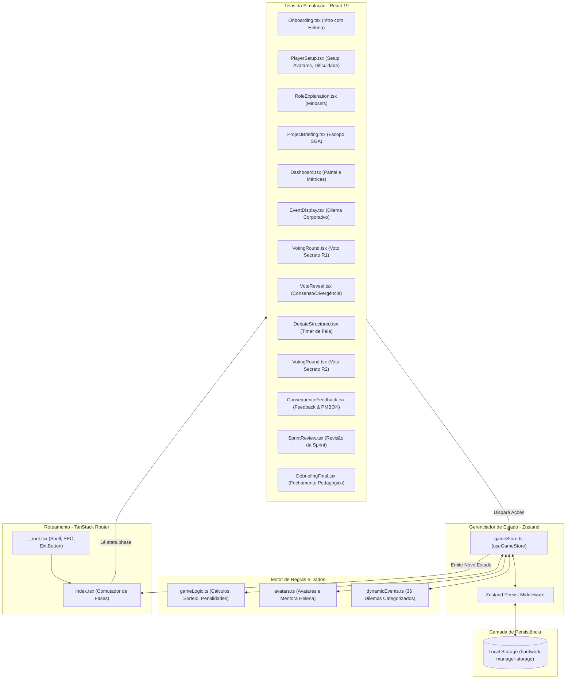
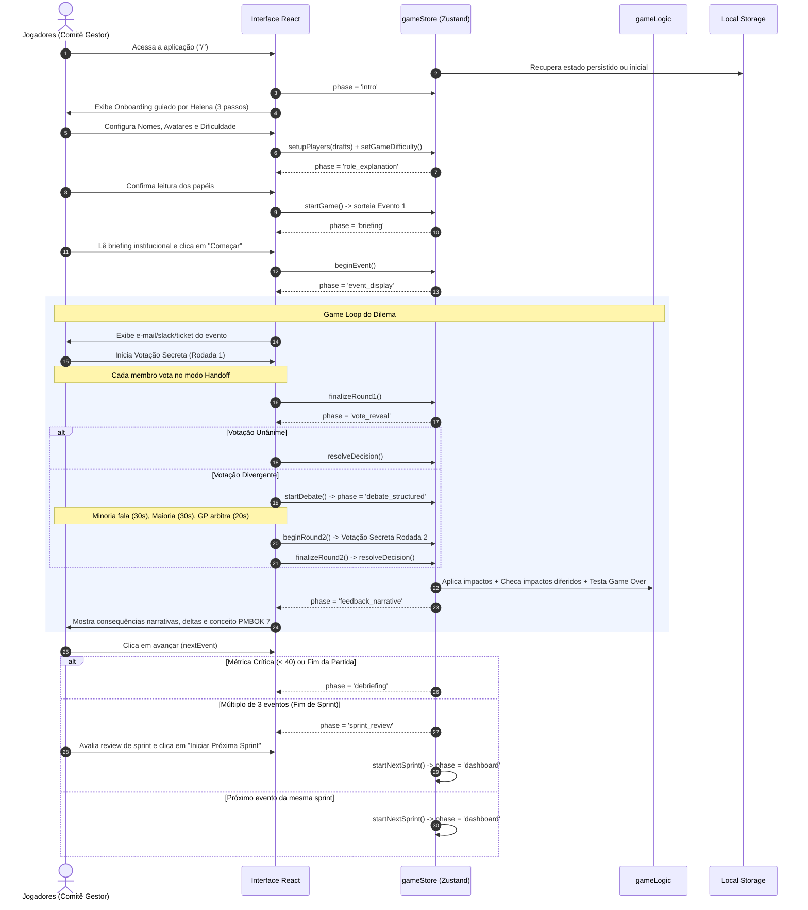
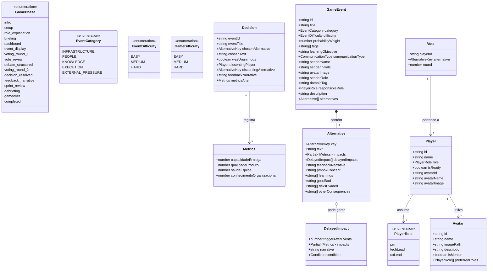
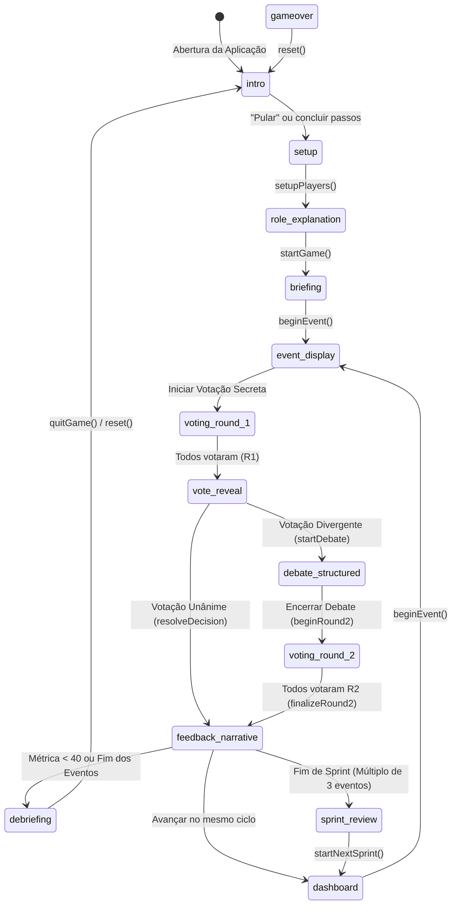
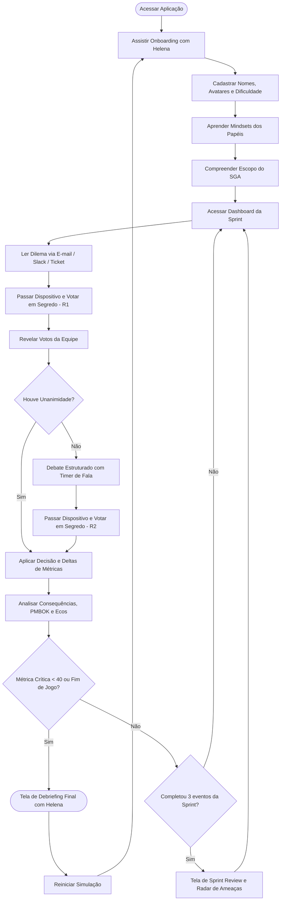
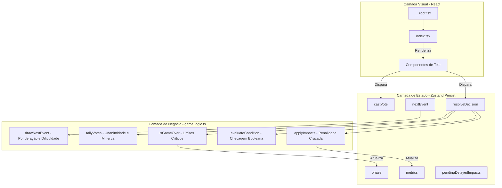
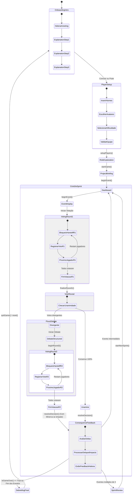

# Documentação Técnica e Funcional: Hard Work Manager
*Simulador Educacional de Gerenciamento de Projetos com base no PMBOK 7 e no Domínio de Desempenho "Trabalho do Projeto"*

---

## 1. Visão Geral do Projeto

### Propósito do Sistema
O **Hard Work Manager** é um jogo sério (*serious game*) desenvolvido como um simulador web colaborativo em turnos locais (*hotseat*). O seu propósito principal é capacitar estudantes e profissionais no gerenciamento de projetos de software, simulando os dilemas, tensões e *trade-offs* táticos durante a modernização do Sistema de Gestão Acadêmica de uma instituição pública de ensino superior (baseada no contexto da Universidade Federal do Ceará - UFC).

### Problema que Resolve
O ensino de gerenciamento de projetos, especialmente sob as diretrizes do **PMBOK 7ª Edição**, costuma ser focado em teorias abstratas e memorização de processos. Alunos frequentemente têm dificuldade em compreender na prática os impactos sistêmicos de decisões críticas sobre a saúde global do projeto. O sistema resolve essa deficiência pedagógica ao materializar em tempo real as relações de causa e efeito entre decisões de escopo, qualidade técnica do código, bem-estar da equipe, fluxo de trabalho (*Lean/Swarming*) e capacidade de entrega contínua.

### Relação com a Gestão de Projetos e PMBOK 7
Diferente das edições anteriores do PMBOK (baseadas estritamente em áreas de conhecimento e processos sequenciais), o PMBOK 7 estrutura o gerenciamento em **Princípios de Entrega de Projetos** e **Domínios de Desempenho**. O jogo transpõe esses princípios subjetivos para mecânicas interativas determinísticas, exigindo que o comitê gestor (formado pelos jogadores) negocie expectativas, gerencie conflitos, blinde a equipe contra desvios de escopo e tome decisões sob limites temporais estruturados.

### Domínio de Desempenho Representado
O núcleo do simulador é o domínio **Trabalho do Projeto** (*Project Work Performance Domain*). Este domínio engloba:
1. Estabelecimento e melhoria contínua de processos eficientes (*Lean*, Teoria das Restrições e eliminação de desperdícios);
2. Gerenciamento equilibrado de recursos humanos, técnicos e operacionais;
3. Manutenção da motivação e combate à sobrecarga da equipe;
4. Comunicação assertiva e engajamento contínuo de stakeholders institucionais;
5. Gestão ativa da dívida técnica e aprendizado organizacional contínuo.

### Público-Alvo e Objetivos de Aprendizagem
* **Público-Alvo**: Estudantes de graduação em Engenharia de Software, Ciência da Computação, Sistemas de Informação e profissionais em capacitação de gestão ágil e tradicional.
* **Objetivos de Aprendizagem**:
  1. Compreender a dinâmica de *trade-offs* inevitáveis em projetos de software (sacrifícios conscientes de curto prazo versus sustentabilidade de longo prazo).
  2. Vivenciar o impacto cumulativo da dívida técnica e dos impactos diferidos (*Delayed Impacts*) que retornam em sprints futuras.
  3. Praticar o gerenciamento de expectativas e a negociação assertiva frente a demandas políticas de stakeholders externos (ex.: Reitoria e Diretorias).
  4. Exercitar a comunicação estruturada sob pressão de tempo por meio de debates com regras claras de priorização de voz.
  5. Assimilar o papel do Gerente de Projetos como facilitador e árbitro em cenários de divergência e empate (*Voto de Minerva*).
  6. Aplicar conceitos avançados de fluxo de valor: *Swarming*, identificação de gargalos de QA, uso de radiadores de informação e mitigação da Lei de Brooks.

---

## 2. Tecnologias Utilizadas

O sistema foi arquitetado com uma stack moderna de alta performance, garantindo tipagem estática ponta a ponta, reatividade modular e persistência de dados no cliente:

| Tecnologia | Onde é utilizada | Função no Projeto | Motivo da Escolha |
| :--- | :--- | :--- | :--- |
| **TypeScript (v5.8+)** | Em todo o código-fonte (`.ts`, `.tsx`) | Tipagem estática, contratos de dados, interfaces e enums. | Elimina erros em tempo de execução e garante integridade nos modelos de eventos e métricas. |
| **React 19** | Componentes e telas (`src/components/*`, `src/routes/*`) | Renderização declarativa da interface e gerenciamento reativo do ciclo de vida. | Ecossistema maduro, compatibilidade com hooks modernos e renderização otimizada. |
| **TanStack Start** | Infraestrutura e Server Entry (`src/start.ts`, `src/server.ts`) | Plataforma full-stack baseada em SSR/Client com suporte a Server Functions tipadas. | Arquitetura unificada de alta velocidade e integração nativa com o roteamento. |
| **TanStack Router** | Roteamento da aplicação (`src/router.tsx`, `src/routes/*`) | Gerenciamento de rotas e metadados SEO com tipagem estática automática. | Roteamento declarativo 100% tipado (`routeTree.gen.ts`) e otimizado. |
| **Zustand (v5.0+)** | Estado global (`src/store/gameStore.ts`) | Gerenciamento do estado centralizado da partida, ações, fases e histórico. | Biblioteca leve, desacoplada de boilerplate, com suporte nativo ao middleware `persist`. |
| **Zustand Persist** | Armazenamento local (`gameStore.ts`) | Sincronização automática do estado do jogo no `localStorage` do navegador. | Previne perda de progresso da partida em caso de recarregamento acidental da página (`F5`). |
| **Tailwind CSS (v4.2+)** | Estilização global e componentes (`src/styles.css`) | Framework CSS utilitário com variáveis CSS nativas e temas customizados. | Produtividade acelerada, micro-animações fluidas e suporte a design tokens consistentes. |
| **Radix UI / Shadcn UI** | Componentes base (`src/components/ui/*`) | Primitivas de interface acessíveis (Dialogs, Tooltips, Accordions, Progress, etc.). | Componentes desacoplados, totalmente acessíveis (WAI-ARIA) e altamente customizáveis. |
| **Lucide React** | Toda a interface gráfica | Biblioteca de ícones vetoriais dinâmicos e responsivos. | Pacote com grande variedade semântica e suporte a tree-shaking. |
| **Zod** | Validação de schemas (`src/lib/api/*`) | Validação estrita de tipos e contratos de dados. | Garantia de segurança de tipos em APIs e dados externos. |
| **Vite (v7.3+) / Nitro** | Build tool, bundler e runtime | Servidor de desenvolvimento HMR ultra-rápido e empacotamento de produção. | Compilação instantânea com ES Modules e bundling otimizado. |

---

## 3. Estrutura Completa do Projeto

Abaixo é apresentado o mapeamento completo dos diretórios e arquivos do repositório:

```
hardworkmanager/
├── public/                      # Assets estáticos servidos diretamente
│   ├── favicon.ico              # Ícone da aplicação
│   └── Personagens/             # Imagens em alta resolução dos Avatares e da Mentora
│       ├── Geraldo.png          # Avatar: Especialista em segurança e auditoria
│       ├── Helena.png           # Mentora: Consultora Ágil e mediadora pedagógica
│       ├── Kendrick.png         # Avatar: Focado em DevOps e CI/CD
│       ├── Kenedy.png           # Avatar: Analista backend e banco de dados
│       ├── Leonara.png          # Avatar: Designer UX/UI e usabilidade
│       ├── Lívia.png            # Avatar: Gestora estratégica de stakeholders
│       ├── Paulyne.png          # Avatar: Especialista em QA e métricas de qualidade
│       ├── Rainara.png          # Avatar: Comunicadora e negociadora
│       └── Roberto.png          # Avatar: Arquiteto de sistemas legados
├── src/
│   ├── components/              # Componentes React da aplicação
│   │   ├── comms/
│   │   │   └── CommViews.tsx    # Visualizações corporativas de dilemas (E-mail, Slack, Ticket)
│   │   ├── screens/             # Telas correspondentes às fases do jogo
│   │   │   ├── Onboarding.tsx          # Apresentação guiada pela Mentora Helena (3 etapas)
│   │   │   ├── PlayerSetup.tsx         # Configuração de equipe, seleção de avatares e dificuldade
│   │   │   ├── RoleExplanation.tsx     # Mindsets e responsabilidades dos 3 papéis
│   │   │   ├── ProjectBriefing.tsx     # Contexto institucional do SGA, metas e métricas iniciais
│   │   │   ├── Dashboard.tsx           # Painel executivo com métricas, radar de sprint e ecos
│   │   │   ├── EventDisplay.tsx        # Exibição detalhada do dilema com canal corporativo
│   │   │   ├── VotingRound.tsx         # Votação secreta em dispositivo compartilhado (Handoff)
│   │   │   ├── VoteReveal.tsx          # Revelação pública dos votos e checagem de consenso
│   │   │   ├── DebateStructured.tsx    # Debate estruturado com cronômetro dinâmico
│   │   │   ├── ConsequenceFeedback.tsx # Feedback da decisão, conceitos PMBOK e impactos diferidos
│   │   │   ├── SprintReview.tsx        # Revisão de encerramento de sprint a cada 3 dilemas
│   │   │   ├── DebriefingFinal.tsx     # Encerramento pedagógico com consolidação de aprendizados
│   │   │   └── GameOver.tsx            # Tela de histórico legada / visualização de fim de jogo
│   │   └── ui/                  # Componentes visuais atômicos (Shadcn + Customizados)
│   │       ├── Avatar3D.tsx            # Componente de avatar estilizado com foto e fallback
│   │       ├── MetricBar.tsx           # Barra de métrica dinâmica com código de cores e transições
│   │       ├── ExitButton.tsx          # Botão flutuante com confirmação para sair/reiniciar
│   │       ├── SoftButton.tsx          # Botão com micro-interações e elevações suaves
│   │       ├── SoftCard.tsx            # Cartão de conteúdo com estilização suave
│   │       └── ...                     # Primitivas Radix UI (dialog, alert, progress, tooltip, etc.)
│   ├── data/                    # Bases de dados estáticas e modulares de eventos e avatares
│   │   ├── avatars.ts           # Definição dos avatares disponíveis e da mentora Helena
│   │   ├── dynamicEvents.ts     # Agregador central dos 50 dilemas dinâmicos
│   │   └── events/              # Módulos temáticos dos 5 Princípios do PMBOK 7 (10 dilemas cada)
│   │       ├── tailoringEvents.ts        # 10 dilemas: Faça a adaptação de acordo com o contexto (Tailoring)
│   │       ├── leadershipEvents.ts       # 10 dilemas: Demonstre comportamentos de liderança
│   │       ├── systemsThinkingEvents.ts  # 10 dilemas: Reconheça, avalie e reaja às interações do sistema
│   │       ├── changeManagementEvents.ts # 10 dilemas: Aceite a mudança para alcançar o futuro estado previsto
│   │       └── qualityEvents.ts          # 10 dilemas: Inclua qualidade nos processos e nas entregas
│   ├── hooks/
│   │   └── use-mobile.tsx       # Hook para detecção responsiva de dispositivos móveis
│   ├── lib/
│   │   ├── api/
│   │   │   └── example.functions.ts     # Exemplo de server functions do TanStack Start
│   │   ├── config.server.ts     # Configurações exclusivas do lado do servidor
│   │   ├── error-capture.ts     # Interceptação de falhas em SSR
│   │   ├── error-page.ts        # Template estático de página de erro
│   │   ├── gameLogic.ts         # Funções puras de regras, cálculos, pesos e condições de derrota
│   │   ├── lovable-error-reporting.ts # Integração cliente com reporte de diagnósticos
│   │   └── utils.ts             # Função utilitária `cn` (clsx + tailwind-merge)
│   ├── routes/
│   │   ├── __root.tsx           # Layout raiz com QueryClient, ExitButton e metadados SEO
│   │   ├── index.tsx            # Rota principal gerenciadora de fases da máquina de estados
│   │   └── README.md            # Documentação interna das rotas do TanStack Router
│   ├── store/
│   │   └── gameStore.ts         # Store central Zustand com middleware de persistência
│   ├── types/
│   │   └── index.ts             # Interfaces TypeScript unificadas de todo o sistema
│   ├── routeTree.gen.ts         # Árvore de rotas tipada gerada automaticamente
│   ├── router.tsx               # Instanciação do roteador TanStack Router
│   ├── server.ts                # Entrypoint do servidor SSR
│   ├── start.ts                 # Middleware do TanStack Start
│   └── styles.css               # Folha de estilos global, variáveis CSS e animações
├── package.json                 # Dependências e scripts de execução
├── tsconfig.json                # Configuração do compilador TypeScript
└── vite.config.ts               # Configuração do Vite e plugins integrados
```

### Relação de Dependência entre os Módulos
1. **Módulo de Contratos e Tipos (`src/types/index.ts`)**: Módulo fundamental. Define enums (`EventCategory`, `EventDifficulty`, `GameDifficulty`), interfaces (`GameEvent`, `Alternative`, `Metrics`, `DelayedImpact`, `Player`, `Decision`, `DebateSpeaker`) e tipos de fases (`GamePhase`).
2. **Módulo de Lógica Matemática Pura (`src/lib/gameLogic.ts`)**: Isola a física das regras: cálculo de penalidade cruzada de conhecimento organizacional, apuração de votos, avaliação de condições booleanas de impactos diferidos e algoritmo ponderado de sorteio de eventos por sprint e dificuldade.
3. **Módulo de Dados (`src/data/*`)**: Estrutura e exporta os avatares disponíveis e a biblioteca com 36 dilemas categorizados com ricas anotações pedagógicas do PMBOK 7.
4. **Módulo de Estado Centralizado (`src/store/gameStore.ts`)**: Orquestra o fluxo de dados, executa as transições de fases, gerencia a persistência via `localStorage`, injeta NPCs dinamicamente e atualiza o histórico de decisões.
5. **Módulo de Roteamento e Telas (`src/routes/index.tsx` e `src/components/screens/*`)**: Renderiza a tela ativa baseando-se na propriedade `phase` da store, desacoplando a interface da lógica de estado.

---

## 4. Arquitetura do Sistema

O sistema emprega uma arquitetura baseada no **Phase-Based State Machine Pattern** acoplada ao padrão de **Fluxo Unidirecional de Dados** (*Flux Architecture*) viabilizado pelo Zustand com middleware de persistência.

### Diagrama Arquitetural Completo



### Ciclo de Vida da Informação
1. **Entrada do Usuário**: O jogador interage com a interface (ex.: seleciona seu avatar, registra voto no *handoff* ou avança de etapa).
2. **Invocação da Ação**: O componente React chama a ação da store (ex.: `castVote('b')`, `resolveDecision()`, `nextEvent()`).
3. **Processamento Determinístico**: A store utiliza funções puras de `gameLogic.ts` para computar os novos valores de métricas, avaliar se há penalidades dobradas por falta de conhecimento organizacional, verificar impactos diferidos ativados e verificar limites de *Game Over*.
4. **Persistência Automática**: O middleware serializa o snapshot do estado no `localStorage`.
5. **Re-renderização e Comutação**: Os seletores do Zustand notificam os componentes e a rota raiz `index.tsx` altera a tela exibida com transições suaves em CSS.

---

## 5. Fluxo de Execução e Game Loop

O fluxo de execução do sistema é estruturado em sprints iterativas de 3 eventos, culminando em uma fase de consolidação pedagógica (*Debriefing*):



---

## 6. Mecânicas do Jogo

O sistema implementa 7 mecânicas integradas para simular o ambiente corporativo e a colaboração sob a ótica do PMBOK 7:

### 1. Mecânica de Hotseat (Passe o Dispositivo)
* **Arquivo**: `src/components/screens/VotingRound.tsx`.
* **Funcionamento**: Permite que múltiplos jogadores participem da tomada de decisão em um único dispositivo físico (notebook, tablet ou smartphone). O fluxo é protegido por um estado de bloqueio (`handoff: true`). Quando um jogador conclui seu voto, a tela é imediatamente ofuscada exibindo o nome e papel do próximo votante. O próximo participante assume o dispositivo e clica em "Estou sozinho com a tela" para liberar suas opções de voto, assegurando o sigilo individual do voto da primeira e da segunda rodadas.

### 2. Mecânica de Debate Estruturado com Timer
* **Arquivos**: `src/components/screens/DebateStructured.tsx` e função `buildOrder`.
* **Funcionamento**: Ativada automaticamente caso a primeira rodada de votação não atinja consenso unânime. O algoritmo analisa a distribuição de votos e estrutura a ordem de fala:
  1. **Vozes Minoritárias Não-GP** (30s cada): Falam primeiro para expor seus argumentos técnicos, riscos ou visão de usuário que a maioria desconsiderou.
  2. **Vozes Majoritárias Não-GP** (30s cada): Apresentam contra-argumentos e justificativas de viabilidade.
  3. **Gerente de Projetos (GP)** (20s): Fala por último para mediar o debate, ponderar o equilíbrio dos recursos e sintetizar a discussão antes da votação decisiva.
* Um cronômetro reativo com suporte a pausa e avanço regula o tempo visualmente, garantindo equidade de fala.

### 3. Mecânica de Apuração e Voto de Minerva
* **Arquivos**: `src/lib/gameLogic.ts` (função `tallyVotes`) e `src/store/gameStore.ts` (`resolveDecision`).
* **Funcionamento**: Os votos da rodada 2 são apurados. Caso haja empate entre alternativas, o sistema busca o voto individual do jogador com papel de Gerente de Projetos (`pm`), atribuindo a ele o **Voto de Minerva**. Se o GP não tiver votado naquelas opções, a primeira opção mais votada é selecionada como critério de desempate determinístico.

### 4. Gestão de 4 Métricas de Desempenho e Penalidade Cruzada
* **Arquivos**: `src/lib/gameLogic.ts` (`applyImpacts`, `clamp`, `isGameOver`) e `src/types/index.ts`.
* **Métricas Modeladas**:
  1. **Capacidade de Entrega (Velocity / Eficiência Operacional)**: Inicia em 100. Representa o ritmo de entrega e a vazão da equipe.
  2. **Qualidade do Produto**: Inicia em 100. Mede a estabilidade arquitetural, aderência técnica e ausência de bugs.
  3. **Saúde da Equipe**: Inicia em 100. Mede a moral, engajamento e clima organizacional dos desenvolvedores.
  4. **Conhecimento Organizacional**: Inicia em 50. Mede a documentação, compartilhamento de conhecimento e mitigação de silos técnicos.
* **Mecânica de Penalidade Cruzada**: Se o *Conhecimento Organizacional* cair abaixo de 20 pontos e uma nova decisão acarretar redução na *Capacidade de Entrega*, **a perda de capacidade é dobrada** (`capacidadeImpact *= 2`). Isso simula a realidade em que equipes sem documentação ou com silos de conhecimento demoram o dobro do tempo para diagnosticar e corrigir falhas no código legado.
* **Condição de Fim de Jogo**: Se qualquer uma das 3 métricas principais (Capacidade, Qualidade ou Saúde) cair abaixo de 40 pontos, o projeto entra em colapso e transiciona para a fase de *Debriefing* de encerramento por falha.

### 5. Mecânica de Impactos Diferidos (Delayed Impacts)
* **Arquivos**: `src/types/index.ts` (`DelayedImpact`), `src/store/gameStore.ts`, `src/lib/gameLogic.ts` (`evaluateCondition`).
* **Funcionamento**: Certas alternativas de decisão geram consequências atrasadas que não impactam o projeto de imediato, mas criam "dívidas" que explodem após $N$ rodadas (`triggerAfterEvents`). A store gerencia a fila de `pendingDelayedImpacts`, decrementando os contadores a cada turno. Quando o contador zera, o sistema avalia condições booleanas opcionais (ex.: `qualidadeProduto < 50`) e aplica penalidades narrativas e numéricas retroativas, exibidas no "Radar de Impactos Diferidos" da Sprint Review e no painel de consequências.

### 6. Mecânica de Geração de Partida Equilibrada (10 Dilemas / 2 por Princípio)
* **Arquivos**: `src/lib/gameLogic.ts` (`generateMatchDeck`) e `src/store/gameStore.ts`.
* **Funcionamento**: A cada nova partida, o simulador gera um baralho de **exatamente 10 dilemas**, garantindo a cobertura pedagógica completa e equilibrada dos 5 princípios do PMBOK 7:
  - **Sorteio sem Repetição**: O algoritmo sorteia aleatoriamente **exatamente 2 dilemas** do acervo de cada um dos 5 princípios (2 do Princípio 1, 2 do Princípio 2, 2 do Princípio 3, 2 do Princípio 4 e 2 do Princípio 5).
  - **Distribuição em Duas Rodadas**: A primeira metade da partida apresenta 1 dilema de cada princípio em ordem pseudoaleatória; a segunda metade apresenta o segundo dilema de cada princípio. Isso evita dilemas consecutivos do mesmo princípio e mantém a experiência pedagógica diversificada.
  - **Estrutura de 4 Sprints**: Os 10 dilemas são organizados em Sprints de trabalho (Sprint 1: dilemas 1 a 3; Sprint 2: dilemas 4 a 6; Sprint 3: dilemas 7 a 9; Sprint 4: dilema 10), intercalados por reuniões de *Sprint Review* com a Mentora Helena.
  - **Níveis de Dificuldade Descontinuados**: A seleção de dificuldade foi removida para assegurar que todas as equipes de estudantes experimentem uma jornada equilibrada e comparável para fins de pesquisa e avaliação pedagógica no TCC 2.

### 7. Injeção Dinâmica de NPCs e Avatares
* **Arquivos**: `src/store/gameStore.ts` (função `injectNPC`), `src/data/avatars.ts`.
* **Funcionamento**: Personagens remetentes de eventos internos (como desenvolvedores pleno, líderes técnicos adjuntos e designers) são sorteados dinamicamente dentre os avatares do catálogo que **não foram escolhidos pelos jogadores humanos**, garantindo variedade visual e imersão em cada partida.

---

## 7. Mapeamento para o PMBOK 7

O jogo transpõe os princípios e práticas do PMBOK 7ª Edição e da gestão ágil/enxuta (*Lean*) diretamente para o comportamento das decisões do simulador:

| Princípio PMBOK 7 / Fundamentação | Manifestação Pedagógica no Jogo | Módulo e Dilemas no Código (10 por Princípio) |
| :--- | :--- | :--- |
| **1. Faça a adaptação de acordo com o contexto (Tailoring)**<br>*(Seção 2.5.1 - Processos do projeto)* | Combate ao Desperdício Burocrático: Otimização e automação de processos, eliminação de formulários inúteis e relatórios duplicados (*Muda*). | `src/data/events/tailoringEvents.ts`<br>(10 dilemas: relatórios PDF vs dashboards, timesheets do PMO, CCB ágil, reuniões excessivas, BDD vs DOCX, homologação ágil de UX, pipeline CI/CD, sincronização de cadastros, estimativas de fluxo, auditoria digital). |
| **2. Demonstre comportamentos de liderança**<br>*(Seção 2.5.3 - Foco da equipe do projeto)* | Liderança Servidora (Blindagem): Proteção dos desenvolvedores contra ruídos externos, contenção de horas extras predatórias, mediação de conflitos e segurança psicológica. | `src/data/events/leadershipEvents.ts`<br>(10 dilemas: escudo de suporte, combate ao burnout, sucessão de sênior, conflito Dev vs UX, blindagem contra assédio, Blameless Post-Mortem, reconhecimento público, quebra de silos, capacitação contínua, proteção de bolsistas). |
| **3. Reconheça, avalie e reaja às interações do sistema (Pensamento Sistêmico)**<br>*(Seção 2.5.2 - Balanceamento de restrições)* | Gestão de Concessões (*Trade-offs*): Efeito dominó de decisões, equilíbrio de restrições concorrentes (prazo, custo, qualidade, moral e conhecimento) e penalidades cruzadas. | `src/data/events/systemsThinkingEvents.ts`<br>(10 dilemas: gambiarra de matrículas, nuvem vs local, decodificação de legado, locks de banco de dados, Oracle vs PostgreSQL, ambiente de Staging, retenção de backups, terceirização com DoD, monólito modular, 2FA gradual). |
| **4. Aceite a mudança para alcançar o futuro estado previsto**<br>*(Seção 2.5.7 - Trabalho novo e mudanças)* | Combate à Distorção de Escopo (*Scope Creep*): Governança de mudanças, gestão de expectativas de stakeholders de alto escalão e adaptação a novas leis e feedbacks de uso. | `src/data/events/changeManagementEvents.ts`<br>(10 dilemas: chatbot com IA do Reitor, resistência de professores, portaria do MEC de diploma digital, adequação à LGPD, demandas da PROGRAD, demo transparente ao Conselho, mudança de API do Gov.br, feedback de piloto, integração de RU, novo manual de marca). |
| **5. Inclua qualidade nos processos e nas entregas**<br>*(Seção 2.5.1 - Processos do projeto)* | Proteção Contra a Dívida Técnica: Resistência à pressa desordenada, *Swarming* com QA, Definition of Done estrita, acessibilidade digital (WCAG) e testes de estresse. | `src/data/events/qualityEvents.ts`<br>(10 dilemas: dívida técnica acumulada, Swarming de QA, hotfix de concorrência, SonarQube e Quality Gates, requisitos ambíguos de IRA, testes de regressão de histórico, integridade de DoD, acessibilidade WCAG 2.1, testes de carga k6, patch de SQL Injection). |

---

## 8. Sistema de Personagens e Avatares

### A Mentora Pedagógica
* **Helena (Consultora Ágil)**: Atua como mediadora educacional e narradora em momentos-chave da jornada:
  - No **Onboarding**, recepciona os participantes e explica o propósito do PMBOK 7.
  - No **Briefing**, apresenta o escopo institucional da modernização do SGA.
  - Na tela de **Consequências**, fornece análises estruturadas sobre o acerto ou equívoco da decisão tomada.
  - Na **Sprint Review**, consolida o desempenho das últimas 3 decisões e alerta sobre ameaças pendentes.
  - No **Debriefing Final**, conduz a retrospectiva de encerramento com métricas e aplicação profissional.

### Papéis do Jogador
Os papéis definidos no tipo `PlayerRole` estabelecem as lentes através das quais os jogadores analisam os problemas:
1. **Gerente de Projetos (PM - Project Manager)**:
   - *Mindset*: "Mindset de Dono".
   - *Responsabilidade*: Alinhamento com stakeholders, proteção dos recursos, gestão de riscos institucionais e resolução de empates via Voto de Minerva.
2. **Líder Técnico (Tech Lead)**:
   - *Mindset*: "Guardião da Performance e Arquitetura".
   - *Responsabilidade*: Estabilidade dos servidores, qualidade do código, testes e combate à dívida técnica.
3. **Líder de Design/UX (UX Lead)**:
   - *Mindset*: "Defensor do Usuário".
   - *Responsabilidade*: Usabilidade, acessibilidade, satisfação de docentes/alunos e redução de fricção na interface.

### Catálogo de Avatares da Equipe
O sistema conta com 8 avatares selecionáveis (`src/data/avatars.ts`), com imagens ilustrativas em `public/Personagens/`:

| Avatar | Nome | Imagem | Especialidade / Descrição | Papéis Recomendados |
| :--- | :--- | :--- | :--- | :--- |
| `geraldo` | Geraldo | `/Personagens/Geraldo.png` | Segurança da informação e auditoria estrutural. | PM, Tech Lead |
| `kendrick` | Kendrick | `/Personagens/Kendrick.png` | Processos operacionais e integração contínua (DevOps). | Tech Lead |
| `kenedy` | Kenedy | `/Personagens/Kenedy.png` | Backend e gerenciamento de banco de dados. | Tech Lead |
| `leonara` | Leonara | `/Personagens/Leonara.png` | Jornada do usuário e acessibilidade de interface. | UX Lead |
| `livia` | Lívia | `/Personagens/Lívia.png` | Visão estratégica, stakeholders e prazos. | PM |
| `paulyne` | Paulyne | `/Personagens/Paulyne.png` | Métricas de qualidade e testes automatizados. | UX Lead, Tech Lead |
| `rainara` | Rainara | `/Personagens/Rainara.png` | Comunicação e negociação de expectativas. | PM, UX Lead |
| `roberto` | Roberto | `/Personagens/Roberto.png` | Arquitetura de software e sistemas legados. | Tech Lead |

---

## 9. Sistema de Cenários e Canais de Comunicação

O jogo utiliza uma metáfora visual de canais de comunicação corporativos (`src/components/comms/CommViews.tsx`) para contextualizar a origem e o tom de cada dilema:

```
               [Mundo Físico / Mesa da Equipe de Alunos]
                                  │
                                  ▼
               [Canais de Comunicação Virtual do Jogo]
 ┌─────────────────────────┬─────────────────────────┬─────────────────────────┐
 │       Canal E-mail      │       Canal Slack       │      Canal Kanban       │
 │       (`EmailView`)     │       (`SlackView`)     │     (`TicketView`)      │
 ├─────────────────────────┼─────────────────────────┼─────────────────────────┤
 │ Mensagens formais de    │ Discussões ágeis e      │ Cartões de tarefas e    │
 │ Reitores, Diretores e   │ informais da equipe     │ bugs com prioridades e  │
 │ Órgãos Reguladores.     │ técnica e designers.    │ tags de arquitetura.    │
 └─────────────────────────┴─────────────────────────┴─────────────────────────┘
```

* **Canal E-mail**: Simula pressões políticas de alto escalão, mudanças de prioridade da Reitoria e auditorias externas. Ensina os alunos a responder formalmente e analisar riscos contratuais e de escopo.
* **Canal Slack**: Reproduz mensagens instantâneas do time, como avisos de sobrecarga de desenvolvedores, atritos entre design e programação ou dúvidas de implementação.
* **Canal Ticket/Kanban**: Simula filas técnicas de incidentes em produção, débito técnico e demandas de infraestrutura.

---

## 10. Sistema de Missões e Catálogo Completo de Eventos

A aplicação conta com um acervo de **50 dilemas rigorosamente modelados**, organizados em **10 dilemas para cada um dos 5 princípios do PMBOK 7** associados ao Domínio Trabalho do Projeto:

### Módulos de Dilemas no Código

| Módulo | Arquivo | Quantidade | Princípio PMBOK 7 Correspondente |
| :--- | :--- | :---: | :--- |
| **1. Tailoring de Processos** | `tailoringEvents.ts` | **10 dilemas** | *Faça a adaptação de acordo com o contexto (Tailoring)* — Combate ao desperdício burocrático e otimização de fluxo (*Lean*). |
| **2. Liderança Servidora** | `leadershipEvents.ts` | **10 dilemas** | *Demonstre comportamentos de liderança* — Blindagem da equipe contra desvios, proteção da moral e combate ao burnout. |
| **3. Pensamento Sistêmico** | `systemsThinkingEvents.ts` | **10 dilemas** | *Reconheça, avalie e reaja às interações do sistema* — Gestão de trade-offs, efeito dominó e restrições interconectadas. |
| **4. Gestão de Mudanças** | `changeManagementEvents.ts` | **10 dilemas** | *Aceite a mudança para alcançar o futuro estado previsto* — Combate à distorção de escopo (*Scope Creep*) e governança formal. |
| **5. Qualidade e Excelência** | `qualityEvents.ts` | **10 dilemas** | *Inclua qualidade nos processos e nas entregas* — Proteção contra a dívida técnica, testes de estresse e acessibilidade. |
| **TOTAL GERAL NO JOGO** | `ALL_DYNAMIC_EVENTS` | **50 dilemas** | *Distribuídos uniformemente nos 5 princípios fundacionais.* |

---

## 11. Sistema de Diálogos e Narrativa Pedagógica

As opções de cada dilema (`Alternative`) não são meras alternativas numéricas, mas peças pedagógicas ricas:

```typescript
export interface Alternative {
  key: AlternativeKey;           // 'a' | 'b' | 'c'
  text: string;                  // Descrição da ação tática proposta
  impacts: Partial<Metrics>;     // Variação direta de métricas
  delayedImpacts?: DelayedImpact[]; // Impactos futuros condicionados
  feedbackNarrative: string;     // Narrativa do desfecho imediato
  pmbokConcept: string;          // Conceito teórico correspondente do PMBOK 7
  learnings: string[];           // Lições práticas consolidadas
  goodBad: string;               // Avaliação qualitativa da Mentora Helena
  risksEvaded: string[];         // Riscos prevenidos ou mitigados
  otherConsequences: string[];   // Análise de "E se outra opção fosse escolhida?"
}
```

Ao tomar uma decisão, a tela `ConsequenceFeedback.tsx` decompõe o aprendizado em 4 camadas:
1. **Comentário de Helena**: Juízo de valor qualitativo sobre a maturidade da decisão.
2. **Conceito PMBOK 7**: Ligação direta com o padrão do PMI.
3. **Riscos Evitados / Criados**: Clareza sobre as contrapartidas assumidas.
4. **Análise Contrafactual (*What If*)**: O que teria acontecido caso a equipe tivesse optado pelas outras alternativas.

---

## 12. Sistema de Dados

O diagrama de classes abaixo detalha o modelo de dados tipado implementado em `src/types/index.ts`:



---

## 13. Estados do Jogo

A máquina de estados finitos do simulador possui 16 estados coordenados pelo Zustand:



---

## 14. Interface do Usuário e Design System

O design visual segue o padrão **Soft UI / Clean Enterprise**, priorizando legibilidade, ergonomia cognitiva e estética moderna:

1. **Paleta Semântica e Cores dos Papéis**:
   - **Gerente de Projetos (PM)**: Índigo/Azul corporativo (`--pm`).
   - **Líder Técnico (Tech Lead)**: Esmeralda/Verde escuro (`--tech`).
   - **Líder de UX (UX Lead)**: Âmbar/Laranja quente (`--ux`).
2. **Indicadores Reativos (`MetricBar.tsx`)**:
   - Transições de 700ms (`transition-all duration-700`).
   - Cores contextuais: Verde para $\ge 70$ (Estável), Amarelo para $40 \le x < 70$ (Atenção), Vermelho para $< 40$ (Crítico).
3. **Sistema de Avatares (`Avatar3D.tsx` e Modal de Seleção)**:
   - Suporte a fotos dos personagens com fallback inteligente para iniciais coloridas.
   - Bloqueio visual dinâmico com etiqueta indicativa ("Selecionado por...") impedindo que dois jogadores escolham o mesmo avatar.
4. **Botão Flutuante de Saída (`ExitButton.tsx`)**:
   - Presente em todas as telas após a introdução.
   - Diálogo com trava de segurança (`AlertDialog`) para evitar saídas acidentais.

---

## 15. Sistema de Áudio

* **Situação Atual no Código**: Não implementado. O sistema prioriza respostas visuais, transições animadas e avisos cromáticos. A inclusão de efeitos sonoros táteis e trilha ambiente suave está documentada no roadmap técnico.

---

## 16. Sistema de Persistência

* **Situação Atual no Código**: **Implementado e Ativo**.
* **Mecanismo**: Utiliza o middleware `persist` do Zustand acoplado ao `localStorage` do navegador sob a chave `hardwork-manager-storage`.
* **Benefícios**:
  - Resiliência completa a recarregamentos de página (`F5`), perda momentânea de conexão ou fechamento involuntário de abas em navegadores de dispositivos móveis.
  - Métodos `reset()` e `quitGame()` limpam explicitamente a chave do storage para permitir o reinício de uma nova partida limpa.

---

## 17. Sistema de Eventos e Reatividade

O simulador adota um modelo reativo orientado a estados:
1. **Triggers (Gatilhos)**: Disparados exclusivamente por eventos de ponteiros do usuário (`onClick`, `onChange`).
2. **Engine de Estado**: Métodos da store realizam mutações imutáveis (`set({ ... })`).
3. **Assinaturas Seletivas**: Componentes React utilizam seletores granulares do Zustand (`useGameStore((s) => s.propriedade)`), minimizando re-renderizações supérfluas e garantindo 60 FPS nas transições de telas.

---

## 18. Inteligência Artificial

* **Situação Atual no Código**:
  - As transições de estado, cálculos matemáticos, penalidades e decisões são governadas por **lógica determinística pura**.
  - Os dilemas envolvendo IA (como `ai_fever`) são recursos narrativos educacionais sobre gestão de expectativas e blindagem de escopo frente ao *hype* tecnológico.
  - A arquitetura está preparada para futura integração com LLMs para geração dinâmica de argumentos de stakeholders.

---

## 19. Fluxograma Completo do Jogador



---

## 20. Fluxograma Completo do Sistema



---

## 21. Pontos Fortes do Projeto

1. **Rigor Conceitual com o PMBOK 7**: A transposição prática de conceitos como *Swarming*, *Muda*, Teoria das Restrições, Radiadores de Informação e mitigação da Lei de Brooks confere valor pedagógico incomparável ao simulador.
2. **Mecânica de Hotseat Polida**: A tela de bloqueio (*handoff*) com transições claras possibilita debates presenciais dinâmicos sem a necessidade de múltiplos computadores por grupo.
3. **Estrutura de Debriefing Rico**: Ao término da partida, o sistema não se limita a exibir "vitória ou derrota", mas gera um relatório detalhado de conceitos assimilados e reflexões customizadas.
4. **Mecanismo de Penalidade Cruzada e Delayed Impacts**: Modela com fidelidade a complexidade de sistemas reais, onde a negligência com documentação ou testes cobra um preço severo em sprints futuras.
5. **Persistência Confiável**: A integração com `localStorage` garante estabilidade operacional mesmo em redes instáveis ou salas de aula conectadas a dispositivos móveis.

---

## 22. Problemas e Riscos do Código

### 1. Ausência de Testes Automatizados (Severidade: Alta)
* **Problema**: O motor matemático e as funções puras (`gameLogic.ts`, `tallyVotes`, `drawNextEvent`, `evaluateCondition`) não possuem suíte de testes unitários automatizados (como Vitest ou Jest).
* **Risco**: Regressões silenciosas em atualizações de regras ou adição de novos dilemas.

### 2. Acoplamento de Eventos no Código-Fonte (Severidade: Média)
* **Problema**: Os 36 dilemas estão declarados em arquivos TypeScript dentro do repositório (`src/data/events/*`).
* **Risco**: Professores e instrutores não conseguem criar ou editar cenários sem clonar o código e efetuar alterações diretas no repositório.

### 3. Falta de Internacionalização (i18n) (Severidade: Baixa)
* **Problema**: Todos os textos narrativos, rótulos de botões e conceitos pedagógicos estão inseridos de forma literal (*hardcoded*) em português.
* **Risco**: Limitação para uso em conferências ou turmas internacionais sem refatoração das strings.

---

## 23. Dívida Técnica

1. **Cobertura de Testes**: Necessidade de configurar Vitest e React Testing Library para testar o fluxo de votação, cálculo de desempate e resolução de impactos diferidos.
2. **Separação de Camadas no TanStack Start**: Centralização de toda a lógica de estado no cliente, subutilizando os recursos de SSR e Server Functions oferecidos pelo framework.
3. **Módulo de Gamificação**: Ausência de pontuação comparativa ou exportação de certificados/relatórios em PDF para submissão pelo aluno ao professor.

---

## 24. Cobertura Educacional

A tabela abaixo sintetiza a cobertura pedagógica alcançada pelo simulador:

| Área Educacional | Nível de Cobertura | Evidência no Jogo |
| :--- | :---: | :--- |
| **Compreensão de Trade-offs** | Excelente | Impossibilidade de maximizar todas as métricas simultaneamente; escolhas exigem sacrifícios táticos conscientes. |
| **Engajamento de Stakeholders** | Excelente | Dilemas de e-mails com Reitoria e PMO ensinam limites de negociação e argumentação estruturada. |
| **Comunicação em Equipe** | Excelente | Timer estruturado obriga a escuta ativa das vozes minoritárias antes do voto de minerva do GP. |
| **Gestão de Dívida Técnica** | Excelente | Mecânica de impactos diferidos tangibiliza o custo futuro de atalhos de programação. |
| **Fluxo de Trabalho Lean** | Excelente | Eventos específicos cobrem *Swarming*, gargalos de QA e eliminação de burocracias. |

---

## 25. Roadmap de Evolução

### Curto Prazo (1-2 meses)
* **Suíte de Testes Automatizados**: Implementação de testes unitários com Vitest cobrindo 100% de `gameLogic.ts`.
* **Exportação de Relatório PDF**: Geração de relatório de desempenho assinado pela Mentora Helena na tela de Debriefing para entrega acadêmica.
* **Efeitos Sonoros**: Implementação de feedback de áudio tátil (cliques, tique-taque do cronômetro e alertas de perigo).

### Médio Prazo (3-6 meses)
* **Importador de Cenários Customizados (CMS / JSON)**: Interface para que professores carreguem arquivos JSON com conjuntos personalizados de eventos e métricas.
* **Modo Multiplayer em Rede (WebSockets / Supabase)**: Substituição do modelo *hotseat* por salas virtuais onde cada aluno vota em seu próprio celular simultaneamente.

### Longo Prazo (6-12 meses)
* **Simulação de Stakeholders com IA Generativa**: Integração com APIs de LLMs para que a Reitoria ou o Líder Técnico respondam por chat dinâmico às argumentações redigidas pelos alunos.

---

## 26. Resumo Executivo

### O que o sistema faz
O **Hard Work Manager** é um simulador sério e colaborativo que coloca estudantes de Engenharia de Software no papel do comitê de liderança responsável pela modernização do Sistema de Gestão Acadêmica da UFC, capacitando-os no Domínio de Desempenho **Trabalho do Projeto** do PMBOK 7.

### Como funciona
Em grupos de 3 a 4 participantes assumindo papéis de Gerente de Projetos, Líder Técnico e Líder de UX, a equipe gerencia dilemas operacionais e crises institucionais. O jogo utiliza rodadas de voto secreto em dispositivo compartilhado (*hotseat*), debates cronometrados com regras de equidade de fala e apuração com Voto de Minerva. As decisões impactam 4 métricas interdependentes, disparam impactos diferidos no tempo e culminam em um debriefing pedagógico conduzido pela Mentora Helena.

### Estado atual do projeto
O projeto está em **estágio totalmente funcional**, com interface de alta fidelidade visual, **50 dilemas modelados** (10 por princípio do PMBOK 7), persistência no `localStorage`, sistema de sprints e debriefing pedagógico completo.

---

## 27. Inventário Técnico Completo

### Arquivos Principais

| Arquivo | Localização | Responsabilidade |
| :--- | :--- | :--- |
| `gameStore.ts` | `src/store/` | Estado central, mutações de fase, persistência e injeção de NPCs. |
| `gameLogic.ts` | `src/lib/` | Funções puras de regras, apuração de votos, penalidade cruzada e sorteio de eventos. |
| `dynamicEvents.ts` | `src/data/` | Agregador central dos 50 dilemas da simulação. |
| `tailoringEvents.ts` | `src/data/events/` | 10 dilemas do Princípio 1: Adaptação de Processos (Tailoring). |
| `leadershipEvents.ts` | `src/data/events/` | 10 dilemas do Princípio 2: Comportamentos de Liderança. |
| `systemsThinkingEvents.ts` | `src/data/events/` | 10 dilemas do Princípio 3: Pensamento Sistêmico e Trade-offs. |
| `changeManagementEvents.ts` | `src/data/events/` | 10 dilemas do Princípio 4: Gestão de Mudanças e Scope Creep. |
| `qualityEvents.ts` | `src/data/events/` | 10 dilemas do Princípio 5: Qualidade e Proteção contra Dívida Técnica. |
| `avatars.ts` | `src/data/` | Definição dos 8 avatares de equipe e da Mentora Helena. |
| `index.tsx` | `src/routes/` | Roteador e comutador central de fases da interface. |
| `__root.tsx` | `src/routes/` | Layout raiz, ExitButton e provedor de QueryClient. |
| `CommViews.tsx` | `src/components/comms/` | Visualizadores de canais corporativos (E-mail, Slack, Ticket). |
| `DebateStructured.tsx` | `src/components/screens/` | Cronômetro e gerenciamento da ordem de fala no debate. |
| `ConsequenceFeedback.tsx` | `src/components/screens/` | Feedback visual, conceitos PMBOK 7 e aprendizados práticos. |
| `SprintReview.tsx` | `src/components/screens/` | Revisão de sprint a cada 3 eventos e radar de impactos diferidos. |
| `DebriefingFinal.tsx` | `src/components/screens/` | Fechamento pedagógico, resumo estatístico e reflexão final. |

### Principais Interfaces e Tipos

| Estrutura | Localização | Descrição |
| :--- | :--- | :--- |
| `GamePhase` | `src/types/index.ts` | Enum com os 16 estados da máquina de estados do jogo. |
| `GameEvent` | `src/types/index.ts` | Estrutura completa de um dilema corporativo. |
| `Alternative` | `src/types/index.ts` | Opção de decisão com impactos, aprendizados e conceitos PMBOK 7. |
| `DelayedImpact` | `src/types/index.ts` | Definição de impacto diferido com contador de eventos e condição. |
| `Metrics` | `src/types/index.ts` | 4 indicadores de desempenho do projeto. |
| `Player` | `src/types/index.ts` | Modelo do jogador com papel e avatar associado. |
| `Decision` | `src/types/index.ts` | Registro histórico de decisão tomada na rodada. |

---

## 28. Anexos Técnicos

### Diagrama de Transição de Estados (Detalhado)


