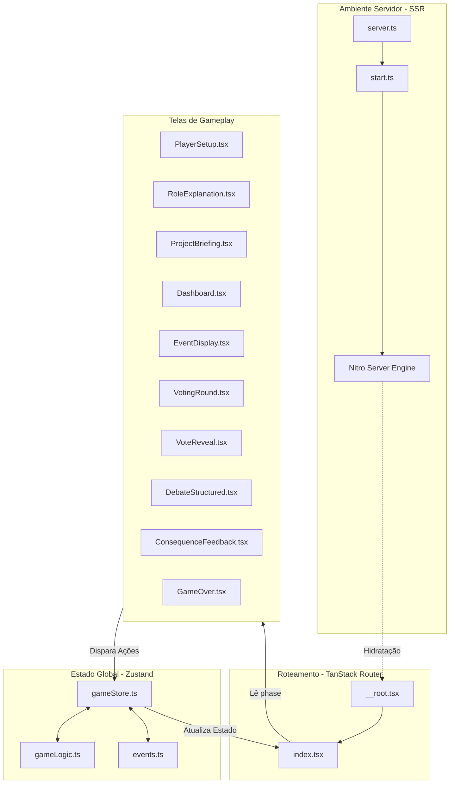
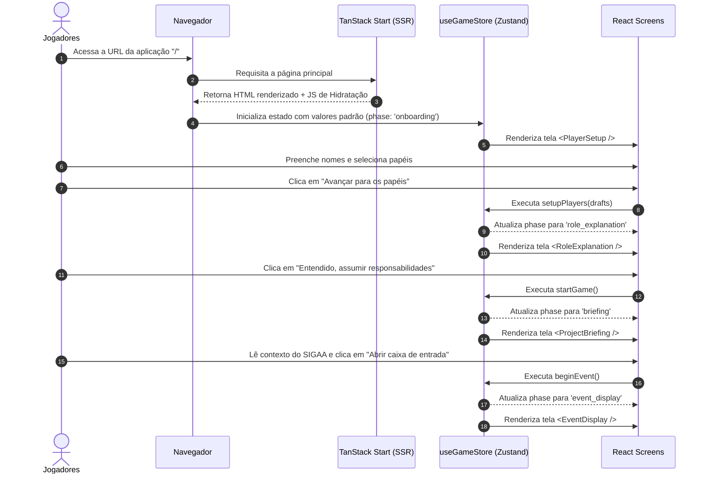
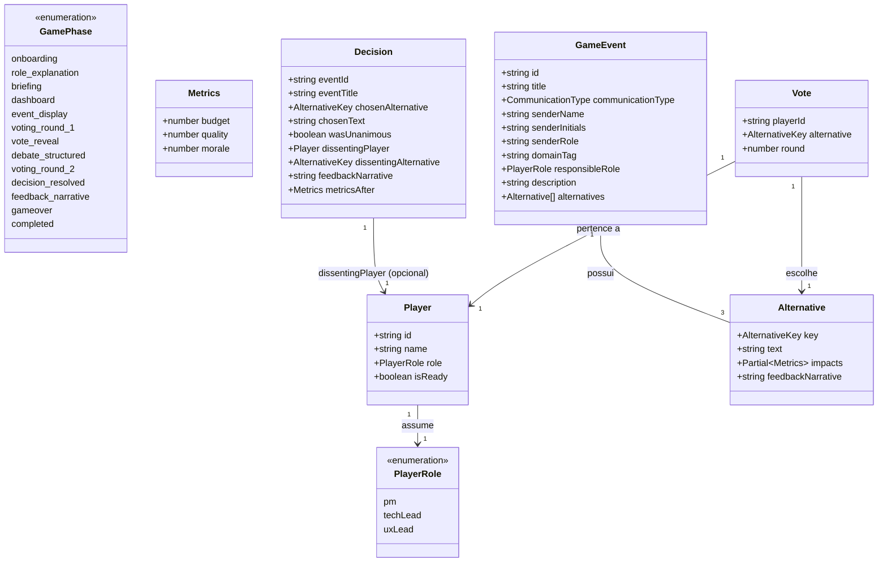
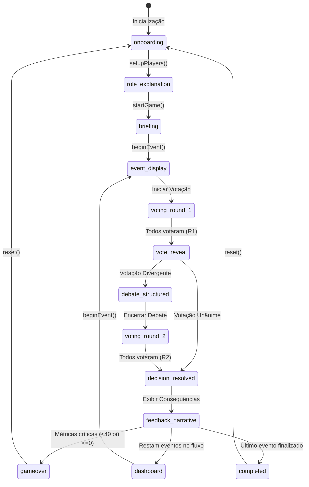
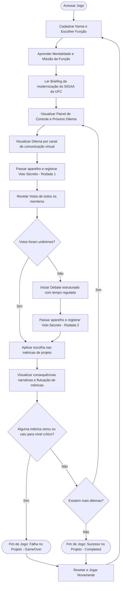
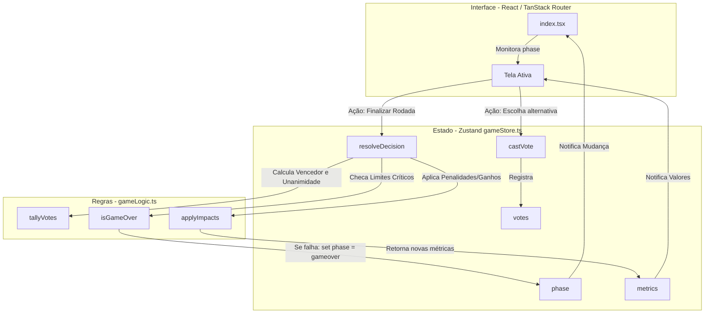
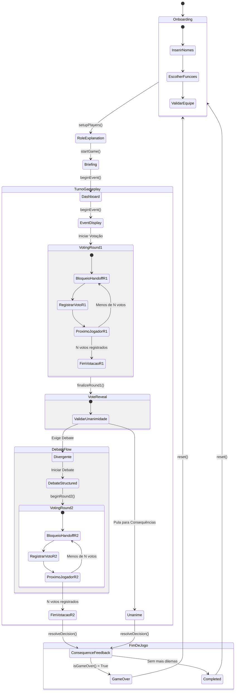

# Documentação Técnica e Funcional: Hard Work Manager
*Simulador Educacional de Gerenciamento de Projetos com base no PMBOK 7 e no Domínio de Desempenho "Trabalho do Projeto"*

---

## 1. Visão Geral do Projeto

### Propósito do Sistema
O **Hard Work Manager** é um jogo sério (*serious game*) desenvolvido como um simulador web colaborativo em turnos locais (*hotseat*). O seu propósito principal é capacitar estudantes e profissionais no gerenciamento de projetos de software, especificamente na modernização do sistema acadêmico de uma universidade federal, simulando as tensões e os trade-offs inerentes a esse cenário.

### Problema que Resolve
O ensino do gerenciamento de projetos, especialmente sob as novas diretrizes do **PMBOK 7ª Edição**, costuma ser focado em aspectos puramente teóricos. Os alunos frequentemente têm dificuldade em compreender de forma prática as consequências de decisões críticas sobre a saúde do projeto. O sistema resolve isso tangibilizando em tempo real a relação entre a alteração de escopo, a qualidade de software, o orçamento do projeto e a moral dos desenvolvedores.

### Relação com a Gestão de Projetos e PMBOK 7
Ao contrário de versões anteriores do PMBOK focadas em áreas de conhecimento baseadas em processos, o PMBOK 7 adota **Princípios de Entrega de Projetos** e **Domínios de Desempenho**. O jogo transpõe estes conceitos subjetivos para mecânicas determinísticas, obrigando o grupo de jogadores (comitê gestor) a debater e buscar o alinhamento de expectativas.

### Domínio de Desempenho Representado
O jogo é estruturado em torno do domínio **Trabalho do Projeto** (*Project Work Performance Domain*). Este domínio trata do estabelecimento de processos eficientes, gerenciamento de recursos físicos e humanos, monitoramento do progresso, comunicação e manutenção do foco na entrega de valor contínuo e equilibrado.

### Público-Alvo e Objetivos de Aprendizagem
*   **Público-Alvo**: Estudantes de graduação em Engenharia de Software, Ciência da Computação, Sistemas de Informação e profissionais em treinamento de gerenciamento de projetos.
*   **Objetivos de Aprendizagem**:
    1.  Compreender a dinâmica de trade-offs na tomada de decisões em projetos de software.
    2.  Vivenciar o impacto qualitativo e quantitativo do acúmulo de dívida técnica.
    3.  Aprender a lidar com pressões e alterações de escopo causadas por stakeholders (ex: Reitoria).
    4.  Praticar a comunicação assertiva e a argumentação sob limite de tempo em debates estruturados.
    5.  Assimilar o papel do Gerente de Projetos como moderador e decisor em situações de empate.

---

## 2. Tecnologias Utilizadas

O sistema adota uma stack moderna e otimizada para o desenvolvimento de aplicações web reativas baseadas em tipagem estática e componentes modulares:

| Tecnologia | Onde é utilizada | Função no Projeto | Motivo Provável da Escolha |
| :--- | :--- | :--- | :--- |
| **TypeScript** | Em todo o código-fonte (`.ts`, `.tsx`) | Garantir tipagem estática e segurança contra erros de tempo de execução. | Melhora a manutenibilidade, autocompletion na IDE e clareza nos contratos de dados. |
| **React 19** | Componentes e telas (`src/components/*`, `src/routes/*`) | Criação da interface com reatividade baseada em estados. | Aproveitamento do ecossistema moderno e renderização declarativa eficiente. |
| **TanStack Start** | Infraestrutura, SSR e Server Entry (`src/start.ts`, `src/server.ts`) | Habilitar renderização híbrida client/server e controle de middleware. | Solução de alta performance para unificar roteamento tipado a funções de servidor nativas. |
| **TanStack Router** | Roteamento do app (`src/router.tsx`, `src/routes/*`) | Controle de rotas e injeção de metadados SEO em tempo de compilação. | Roteamento totalmente tipado e otimizado para React. |
| **Zustand v5** | Estado global (`src/store/gameStore.ts`) | Gerenciar dados do jogo (jogadores, votos, métricas, fases de jogo). | Extremamente leve, reativo, com menor boilerplate do que Redux ou React Context API. |
| **Tailwind CSS v4** | Estilização global e de componentes (`src/styles.css`) | Framework CSS utilitário para design rápido e responsivo. | Agiliza a escrita de estilos e provê suporte a temas modernos nativos. |
| **Shadcn UI / Radix** | Componentes de base (`src/components/ui/*`) | Fornecer a fundação acessível para os elementos visuais. | Biblioteca headless altamente customizável e acessível por padrão. |
| **Lucide React** | Ícones de interface | Fornecer biblioteca consistente de ícones vetoriais. | Fácil integração com React e peso de bundle reduzido. |
| **Zod** | Validação de entradas e tipos (`src/lib/api/example.functions.ts`) | Validação de payloads no lado do cliente e do servidor. | Integração nativa com o TanStack Router/Start para APIs e schemas seguros. |
| **Nitro / Vite v7** | Servidor de build e runtime | Compilação e execução do servidor de desenvolvimento e de produção. | Velocidade de carregamento instantânea via ES Modules (Vite) e engine SSR leve (Nitro). |

---

## 3. Estrutura Completa do Projeto

Abaixo é apresentada a árvore completa de diretórios e arquivos com as respectivas responsabilidades identificadas:

```
hardworkmanager/
├── .lovable/                 # Metadados de ambiente da plataforma de prototipação Lovable
├── public/                  # Arquivos estáticos (imagens, favicon, manifestos)
├── src/
│   ├── components/          # Componentes reutilizáveis de tela e UI
│   │   ├── comms/
│   │   │   └── CommViews.tsx  # Componentização dos canais de comunicação (E-mail, Slack, Ticket)
│   │   ├── screens/
│   │   │   ├── ConsequenceFeedback.tsx  # Tela de resultados quantitativos/narrativos do dilema
│   │   │   ├── Dashboard.tsx            # Painel com métricas de progresso e estado geral
│   │   │   ├── DebateStructured.tsx     # Mecânica com timer para debates estruturados
│   │   │   ├── EventDisplay.tsx         # Exibição do dilema recebido por canal corporativo
│   │   │   ├── GameOver.tsx             # Exibição do encerramento (derrota ou sucesso final)
│   │   │   ├── PlayerSetup.tsx          # Cadastro de jogadores e atribuição de funções
│   │   │   ├── ProjectBriefing.tsx      # Narrativa introdutória do projeto do SIGAA
│   │   │   ├── RoleExplanation.tsx      # Mindsets e responsabilidades de cada papel
│   │   │   ├── VoteReveal.tsx           # Exibição dos votos secretos da primeira rodada
│   │   │   └── VotingRound.tsx          # Entrada de voto secreto individual (Handoff)
│   │   └── ui/              # Componentes de design atômico (Shadcn + Customizados)
│   │       ├── Avatar3D.tsx             # Renderização de avatar colorido por papel
│   │       ├── MetricBar.tsx            # Barra de progresso dinâmica com cores de status
│   │       ├── SoftButton.tsx           # Botão customizado com sombras suaves e micro-interação
│   │       ├── SoftCard.tsx             # Card estrutural com estilo glassmorphism suave
│   │       └── ...                      # Demais 46 arquivos shadcn UI (accordion, dialog, form, etc.)
│   ├── data/
│   │   └── events.ts        # Base de dados estática dos dilemas (GAME_EVENTS)
│   ├── hooks/
│   │   └── use-mobile.tsx   # Hook para detecção de largura de tela de celular
│   ├── lib/
│   │   ├── api/
│   │   │   └── example.functions.ts     # Exemplo de server function integrada ao TanStack Start
│   │   ├── config.server.ts # Arquivo de configuração restrito ao servidor (NodeJS/Cloudflare)
│   │   ├── error-capture.ts # Interceptador de erros para renderização no lado do servidor (SSR)
│   │   ├── error-page.ts    # Template HTML estático de erro para o usuário final
│   │   ├── gameLogic.ts     # Funções puras de regras de jogo (cálculo de votos, limites, impactos)
│   │   ├── lovable-error-reporting.ts # Integração cliente com reporte de bugs
│   │   └── utils.ts         # Wrapper do tailwind-merge e clsx para junção de classes CSS
│   ├── routes/
│   │   ├── __root.tsx       # Layout raiz, provedores e metadados globais HTML/SEO
│   │   └── index.tsx        # Gerenciador de fases de exibição baseado no Zustand
│   ├── store/
│   │   └── gameStore.ts     # Gerenciamento de estado centralizado (Zustand store)
│   ├── types/
│   │   └── index.ts         # Definições de tipos TypeScript unificados do projeto
│   ├── routeTree.gen.ts     # Árvore de rotas gerada automaticamente pelo TanStack Router
│   ├── router.tsx           # Configuração de instância do TanStack Router
│   ├── server.ts            # Ponto de entrada do servidor SSR com captura de falhas
│   ├── start.ts             # Middleware de inicialização do TanStack Start
│   └── styles.css           # Tema do Tailwind v4 com cores customizadas e animações
├── tsconfig.json            # Configuração do compilador TypeScript
├── vite.config.ts           # Configuração do Vite e plugins integrados
└── package.json             # Definição de dependências e scripts do projeto
```

### Relação de Dependência entre Módulos
1.  **Módulo de Tipos (`src/types/index.ts`)**: Módulo folha. Todos os arquivos de dados, lógica e componentes o importam diretamente para conformidade.
2.  **Módulo de Lógica Pura (`src/lib/gameLogic.ts`)**: Depende dos tipos. Contém a física matemática do jogo (ex: limites de 0 a 100, regras de unanimidade).
3.  **Módulo de Armazenamento (`src/store/gameStore.ts`)**: Importa os dados de `src/data/events.ts` e a lógica de `src/lib/gameLogic.ts`. É o "cérebro" do jogo.
4.  **Módulo de Rota Principal (`src/routes/index.tsx`)**: Importa a store para ler a propriedade `phase` e comutar dinamicamente qual tela instanciar.
5.  **Módulo de Componentes de Tela (`src/components/screens/*`)**: Consomem dados e disparam métodos da `gameStore.ts` para interagir com o fluxo.

---

## 4. Arquitetura do Sistema

O sistema adota o padrão **Phase-Based State Pattern** acoplado a um fluxo unidirecional de dados. Como o roteador (`src/routes/index.tsx`) monitora o estado global do Zustand, a comutação de telas funciona como uma máquina de estados finitos centralizada.

### Diagrama Arquitetural de Componentes e Fluxo



### Comunicação e Fluxo de Dados
1.  **Ação do Usuário**: O jogador clica em um botão (ex: registrar voto).
2.  **Disparo do Estado**: O componente de tela invoca um método da store (ex: `castVote(alt)`).
3.  **Processamento Lógico**: A store computa o novo estado invocando funções utilitárias puras (ex: `applyImpacts` ou `tallyVotes`).
4.  **Propagação Reativa**: O Zustand avisa o React sobre as atualizações. O React renderiza novamente a interface. Se a propriedade `phase` tiver mudado, o roteador substitui a tela inteira com transição suave.

---

## 5. Fluxo de Execução

Ao iniciar a aplicação, a seguinte sequência cronológica de eventos é executada:



### Passo a Passo do Loop Principal (Game Loop)
1.  **Exibição do Dilema**: `EventDisplay.tsx` mostra o evento. Ao avançar, entra em `voting_round_1`.
2.  **Voto Secreto (1ª Rodada)**: Cada jogador vota em segredo no aparelho (`VotingRound.tsx`).
3.  **Revelação dos Votos**: `VoteReveal.tsx` expõe as decisões individuais:
    *   **Se Unânime**: Pula para o passo 6 (`resolveDecision()`).
    *   **Se Divergente**: Dispara o passo 4 (`startDebate()`).
4.  **Debate Estruturado**: O cronômetro regula o tempo de fala de cada membro (`DebateStructured.tsx`).
5.  **Voto Secreto (2ª Rodada)**: Novo ciclo de voto secreto (`VotingRound.tsx` com `round={2}`).
6.  **Cálculo e Consequência**: A store processa a opção vencedora (`resolveDecision()`). Atualiza as métricas e exibe a narrativa de consequências (`ConsequenceFeedback.tsx`).
7.  **Transição de Turno**: O jogo verifica se houve falha nas métricas:
    *   **Sim (Métrica Crítica)**: `phase` transiciona para `gameover`.
    *   **Não e restam eventos**: Incrementa índice e retorna ao `dashboard`.
    *   **Não e acabaram os eventos**: Transiciona para `completed` (Sucesso).

---

## 6. Mecânicas do Jogo

O sistema possui mecânicas implementadas para simular o ambiente corporativo e a colaboração em equipe:

### 1. Mecânica de Hotseat (Passe o Dispositivo)
*   **Onde está implementada**: `src/components/screens/VotingRound.tsx`.
*   **Funcionamento**: Controlado pelo estado booleano `handoff`. Quando um jogador termina de votar, a tela de bloqueio é exibida informando o nome do próximo jogador. O voto do jogador anterior é ocultado imediatamente. O próximo jogador clica em "Estou sozinho com a tela" para liberar suas opções de voto. Isso possibilita a votação secreta em um único dispositivo físico compartilhado.

### 2. Mecânica de Debate Estruturado com Timer
*   **Onde está implementada**: `src/components/screens/DebateStructured.tsx` e função `buildOrder`.
*   **Funcionamento**: Se a votação não for unânime na rodada 1, o debate é ativado. O algoritmo calcula qual foi a alternativa minoritária e ordena os falantes:
    1.  Membros que não são o PM e votaram na minoria falam primeiro (30s cada) para apresentar seus argumentos técnicos/de design.
    2.  Membros que não são o PM e votaram na maioria falam a seguir (30s cada) para contra-argumentar.
    3.  O Gerente de Projetos (PM) fala por último (20s) para arbitrar.
    Um cronômetro dinâmico em tela (`setInterval`) decrementa os segundos de fala do orador da vez, com opções de pausar e pular.

### 3. Mecânica de Tally e Desempate (Voto de Minerva)
*   **Onde está implementada**: `src/lib/gameLogic.ts` (função `tallyVotes`) e `src/store/gameStore.ts` (método `resolveDecision`).
*   **Funcionamento**: Os votos são contados. Em caso de empate na rodada 2, a store busca o voto registrado pelo jogador com papel de Gerente de Projetos (`pm`). A alternativa escolhida pelo PM é eleita vencedora do turno. Caso o PM não tenha votado, escolhe-se a primeira alternativa dentre as mais votadas.

### 4. Mecânica de Gestão de Métricas
*   **Onde está implementada**: `src/lib/gameLogic.ts` (funções `applyImpacts`, `clamp` e `metricLevel`).
*   **Funcionamento**: Três métricas numéricas flutuam entre 0 e 100: **Orçamento (budget)**, **Qualidade (quality)** e **Moral (morale)**. A função `clamp` impede valores fora do intervalo 0-100. Níveis menores que 40 colocam o jogo em estado de aviso/crítico. Se a saúde cair para 0 no Orçamento, ou abaixo de 40 na Qualidade/Moral, a partida é imediatamente interrompida.

---

## 7. Mapeamento para o PMBOK 7

O jogo transpõe conceitos e princípios teóricos do PMBOK 7ª Edição para o comportamento prático de decisões técnicas e de design.

### Tabela de Mapeamento de Conceitos

| Conceito PMBOK 7 | Implementação no jogo | Arquivos responsáveis |
| :--- | :--- | :--- |
| **Domínio de Desempenho: Trabalho do Projeto** | O fluxo de recebimento de tickets e e-mails, processamento de recursos (orçamento/esforço) e monitoramento de métricas. | `src/store/gameStore.ts`, `src/components/screens/Dashboard.tsx` |
| **Princípio: Foco no Valor** | O dilema da "Febre da IA" confronta a equipe entre gastar orçamento para criar um chatbot de valor superficial ou manter foco na estabilidade do fluxo de login e matriculas do SIGAA. | `src/data/events.ts` (evento `ai_fever`) |
| **Gerenciamento de Mudanças** | Eventos inesperados exigindo alteração drástica de escopo vindos da Reitoria. O comitê deve negociar o escopo ou sofrer punição técnica/financeira. | `src/data/events.ts` (evento `ai_fever`) |
| **Navegar na Complexidade** | O dilema "O Caos do Código Legado" simula a complexidade arquitetural do SIGAA e o impacto de integrar novas funcionalidades sem resolver dívidas técnicas pré-existentes. | `src/data/events.ts` (evento `code_chaos`) |
| **Engajamento dos Stakeholders** | A necessidade de equilibrar as exigências da Reitoria e da PROGRAD mantendo a viabilidade técnica e financeira acordada. | `src/components/screens/ProjectBriefing.tsx`, `src/data/events.ts` |
| **Foco na Qualidade (Entregas)** | A métrica "Qualidade" mede o nível operacional do SIGAA. Decisões apressadas reduzem a qualidade, levando a falhas críticas apontadas pelos stakeholders. | `src/lib/gameLogic.ts` (função `isGameOver`) |

### Conceitos Ausentes do PMBOK 7 no Jogo
*   **Domínio de Desempenho: Planejamento**: Não há estimativas formais de tempo, cronogramas de marcos ou planejamento de capacidade física de recursos.
*   **Domínio de Desempenho: Métricas (Medição)**: Ausência de KPIs detalhados como Earned Value Management (EVM), Burn-down charts ou taxas de defeito.
*   **Princípio: Liderança Organizacional**: Não há simulação de liderança e desenvolvimento de competências individuais do time além da negociação coletiva.

### Sugestões de Melhoria de Aderência
1.  **Mecanismo de Riscos**: Introduzir um "Registro de Riscos" em que certas escolhas gerem probabilidade (ex: 30% de chance) de desencadear um evento catastrófico em rodadas futuras, em vez de consequências meramente determinísticas.
2.  **Métrica de Cronograma**: Adicionar uma métrica de "Tempo/Prazo" (Ex: Semanas restantes para a matrícula) que é consumida a cada rodada de debate ou refatoração.

---

## 8. Sistema de Personagens

### Papéis do Jogador
Os papéis disponíveis são definidos no tipo `PlayerRole` em `src/types/index.ts`. Cada um deles possui responsabilidades específicas dentro da simulação:

1.  **Gerente de Projetos (PM - Project Manager)**
    *   **Mindset**: "Mindset de Dono" e Gestão de Stakeholders.
    *   **Responsabilidade**: Balancear o orçamento e gerenciar as pressões políticas da Reitoria.
    *   **Mecânica**: Atua como o árbitro final no debate e possui o voto de minerva para desempates na rodada 2.
    
2.  **Líder Técnico (Tech Lead)**
    *   **Mindset**: "Guardião da Performance" e Arquitetura de Software.
    *   **Responsabilidade**: Zelar pela qualidade de software, prevenção de dívida técnica crônica e estabilidade física do sistema.
    
3.  **Líder de Design/UX (UX Lead)**
    *   **Mindset**: "Defensor do Usuário".
    *   **Responsabilidade**: Garantir fluxos de uso intuitivos, acessibilidade das telas e satisfação visual dos alunos e professores da universidade.

### NPCs (Stakeholders/Remetentes)
Os NPCs não possuem movimentação ou tomada de decisões ativas, agindo como geradores de eventos narrativos:
*   **Carlos Silva (Desenvolvedor Sênior)**: Emite avisos e relata problemas técnicos graves de acoplamento nos módulos do SIGAA.
*   **Gabinete da Reitoria (Reitor)**: Stakeholder político máximo do projeto, demanda inovações repentinas com prazos irreais sem compreender o impacto de engenharia de software.

---

## 9. Sistema de Cenários

O jogo adota um design abstrato e textual-narrativo para representar seus ambientes. Não há movimentação física de personagens em um mapa 2D ou 3D. Os cenários são simulações de canais de comunicação de escritórios digitais:

```
[Mundo Físico / Sala de Reuniões Real]
           │
           ▼
[Cenários de Comunicação Virtual do Jogo]
 ├── Caixa de E-mails (Comunicação Formal de Stakeholders externos - Reitor)
 ├── Slack Corporativo (Comunicação Informal ágil e interna do time)
 └── Quadro de Tickets Kanban (Comunicação Técnica de Arquitetura e Bugs)
```

### Funcionalidade Pedagógica dos Cenários
*   **Canal E-mail (EmailView)**: Simula o contexto em que as pressões políticas e solicitações de escopo de alto nível chegam ao projeto. O objetivo pedagógico é ensinar a analisar mensagens formais e identificar exigências que afetam o escopo de forma crítica.
*   **Canal Slack (SlackView)**: Simula a dinâmica interna da equipe de tecnologia. Tem como objetivo aproximar o aluno da realidade de discussões rápidas e feedback ágil de desenvolvimento.
*   **Canal Ticket (TicketView)**: Simula a fila de trabalho técnico. Ensina o aluno a reconhecer o débito técnico e os problemas estruturais de engenharia como "tarefas de projeto" que competem diretamente com novas funcionalidades.

---

## 10. Sistema de Missões

As missões são representadas pelos próprios dilemas do jogo. Atualmente, existem duas grandes missões:

### Missão 1: O Caos do Código Legado
*   **Objetivo**: Realizar a integração do sistema de matrículas com o novo sistema de bolsas, lidando com um código de alto acoplamento sob risco de queda do banco de dados.
*   **Condições de Sucesso**: Selecionar a Alternativa B ("Atitude de dono: parar para refatorar"). Embora consuma 15 de Orçamento, aumenta a Qualidade em 20 e a Moral em 10.
*   **Condições de Falha**: Fazer a integração apressada (Alternativa A) gera -20 de Qualidade e -10 de Moral. A entrega parcial (Alternativa C) gera -5 de Qualidade e -15 de Moral. Se qualquer métrica violar as condições de saúde de jogo, a missão fracassa.
*   **Aprendizagem**: Compreender que acumular dívida técnica consciente pode trazer uma entrega rápida no curto prazo, mas gera falhas severas e desgaste da equipe a médio prazo.

### Missão 2: A Febre da IA
*   **Objetivo**: Lidar com a solicitação urgente do Reitor para incluir um assistente virtual de inteligência artificial no SIGAA em apenas um mês.
*   **Condições de Sucesso**: Negociar e adiar a funcionalidade (Alternativa A), o que não consome verba e aumenta em 15 a Qualidade e a Moral por blindar o time.
*   **Condições de Falha**: Acatar imediatamente (Alternativa B: -20 Orçamento, -15 Qualidade, -15 Moral) ou terceirizar de forma malfeita (Alternativa C: -30 Orçamento, -5 Moral).
*   **Aprendizagem**: O gerente de projetos deve saber gerenciar expectativas dos stakeholders políticos e aprender que dizer "não" de forma fundamentada e com propostas estruturadas é essencial para proteger a equipe e a qualidade técnica do produto.

---

## 11. Sistema de Diálogos

O sistema de diálogos é passivo e integrado às visualizações de canais de comunicação e feedback de consequências.

*   **Armazenamento dos Dados**: Os diálogos e textos narrativos são estruturados estaticamente no arquivo `src/data/events.ts`. O objeto de cada evento possui campos como `description` (que contém o diálogo/mensagem do remetente) e `feedbackNarrative` (que contém a história do desfecho de cada alternativa).
*   **Estrutura de Dados**:
    ```typescript
    export interface Alternative {
      key: AlternativeKey;
      text: string;           // Texto explicativo da opção de voto
      impacts: Partial<Metrics>;
      feedbackNarrative: string; // Diálogo/Feedback gerado após a tomada da decisão
    }
    ```
*   **Condições de Ativação**:
    *   **Mensagem Inicial**: Disparada ao entrar no estado `event_display`.
    *   **Mensagem de Desfecho**: Ativada após o encerramento do processo de votação (`resolveDecision()`), exibida na tela `ConsequenceFeedback.tsx`.

---

## 12. Sistema de Dados

O sistema de dados é totalmente modelado em TypeScript na pasta `src/types/index.ts`. O diagrama abaixo detalha o relacionamento entre as principais entidades de dados do jogo:



---

## 13. Estados do Jogo

O ciclo de vida do jogo é governado por uma máquina de estados finitos cujo estado atual é guardado na propriedade `phase` da store.

### Diagrama de Transição de Estados



---

## 14. Interface do Usuário

O projeto possui uma interface refinada com foco em experiência do usuário premium (glassmorphism/neumorphism leve) estruturada nos seguintes blocos:

1.  **Tela de Setup (`PlayerSetup`)**:
    *   **Formulário de Entrada**: Campos de inputs de texto com sombras internas suaves (`shadow-[var(--shadow-inset-soft)]`) para digitação dos nomes.
    *   **Menu de Seleção de Papéis**: Dropdown estilizado para alocar os papéis. Se um 4º jogador for inserido, o sistema bloqueia e força o papel a `uxLead` automaticamente.
2.  **Painel Executivo / HUD (`Dashboard`)**:
    *   **Métricas de Projeto (`MetricBar`)**: Três cards com ícones representativos (Coins, Sparkle, Heart). Cada indicador possui uma barra de carregamento com transição de 700ms (`transition-all duration-700`). As cores mudam dinamicamente baseadas nas regras de negócio (Verde se >= 70, Amarelo se < 70, Vermelho se < 40). O card reflete a cor da métrica emitindo uma sombra colorida difusa na borda.
    *   **Lista de Progresso**: Painel lateral que exibe os dilemas passados riscados com efeito tachado (`line-through`) e destaca o dilema atual.
3.  **Telas de Votação e Bloqueio (`VotingRound`)**:
    *   **Tela de Bloqueio (Handoff)**: Fundo escurecido minimalista com ícone de cadeado e olho cortado (`EyeOff`/`Lock`). Exibe em destaque o nome do jogador que deve assumir o controle do aparelho.
    *   **Opções de Votação**: Botões grandes organizados em pilha vertical que revelam efeitos de translação para cima de -2px e aumento de sombra no hover (`hover:-translate-y-0.5 hover:shadow-[var(--shadow-soft-lg)]`).
4.  **Painel de Consequências (`ConsequenceFeedback`)**:
    *   **Indicadores de Variação**: Mostra setas dinâmicas verdes apontando para cima (`TrendingUp`) e vermelhas para baixo (`TrendingDown`) indicando os ganhos ou perdas de métricas causados pela decisão.

---

## 15. Sistema de Áudio

### Situação Atual no Código
*   **Não Implementado**: O projeto atual carece inteiramente de elementos sonoros. Não há arquivos de áudio nos diretórios de assets públicos, nem carregamento de áudio ou instâncias de Web Audio API/HTMLAudioElement nos arquivos do código-fonte.

---

## 16. Sistema de Persistência

### Situação Atual no Código
*   **Não Implementado**: O estado do jogo é mantido na memória RAM através do Zustand. Não há chamadas a APIs de gravação persistente como `localStorage.setItem` ou conexões com bancos de dados. Qualquer recarregamento manual da página (`F5` ou perda de conexão temporária) redefine o estado do jogo e obriga o grupo a iniciar a partida do onboarding.

---

## 17. Sistema de Eventos

A aplicação utiliza um sistema interno baseado na arquitetura reativa do Zustand. Não são emitidos eventos customizados do browser (`new CustomEvent()`), delegando toda a sincronização para o ciclo de renderização do React.

```
 [Ação na Tela React]
          │
          ▼ (Executa chamada)
 [gameStore.ts: action]
          │
          ▼ (Calcula nova versão)
 [gameStore.ts: set({ ... })]
          │
          ▼ (Notifica componentes inscritos)
 [React DOM re-render]
```

*   **Triggers (Gatilhos)**: Cliques dos jogadores em opções de votos, botões de avanço de fase ou cliques de início/fim de debates.
*   **Listeners (Ouvintes)**: Componentes React que utilizam o hook `useGameStore((state) => state.propriedade)` e provocam a atualização automática das telas ao captar variações.

---

## 18. Inteligência Artificial

### Situação de Inteligência Artificial no Projeto
*   **Não Aplicável / Não Implementado**: Não há agentes inteligentes, redes neurais, processamento de linguagem natural ou tomada de decisão heurística por parte de algoritmos de computador no código-fonte do jogo. As transições de estado do jogo são puramente baseadas em lógica imperativa determinística, e as decisões de projeto são tomadas exclusivamente por jogadores humanos. 
*   *Nota*: A temática de inteligência artificial é tratada de forma estritamente ficcional/narrativa no dilema "A Febre da IA" (`ai_fever`) no arquivo `src/data/events.ts`.

---

## 19. Fluxograma Completo do Jogador

Abaixo é ilustrado todo o percurso e tomada de decisões que o jogador realiza de ponta a ponta na aplicação:



---

## 20. Fluxograma Completo do Sistema

Este diagrama apresenta o fluxo interno da aplicação, destacando os módulos responsáveis pelo processamento em segundo plano:



---

## 21. Pontos Fortes do Projeto

1.  **Uso Eficiente de Roteamento com Type-Safety**: A integração do TanStack Router com TanStack Start impede falhas de navegação e inconsistências de rotas.
2.  **Arquitetura Baseada em Fases Elegante**: A ausência de roteamento complexo na gameplay, usando apenas um comutador de estado `phase` no `index.tsx`, simplifica o fluxo e reduz a latência de transição de telas.
3.  **Excelente Algoritmo de Priorização de Voz**: A ordenação do debate em `DebateStructured.tsx` garante valor pedagógico, colocando o PM no final como moderador e promovendo as vozes minoritárias inicialmente.
4.  **Identidade Visual Coesa e Agradável**: Design limpo e premium com cores específicas para cada papel e representações gráficas excelentes das comunicações institucionais da UFC (estilo de e-mail formal, slack e kanban).

---

## 22. Problemas e Riscos do Código

Esta seção lista riscos arquiteturais e de código identificados no projeto atual:

### 1. Ausência de Persistência do Estado (Severidade: Alta)
*   **Problema**: O jogo confia inteiramente no estado volátil da memória ram do browser. Se o jogador atualizar a página acidentalmente (`F5`), perderá a partida no meio do jogo.
*   **Risco**: Frustração do usuário final em dispositivos móveis caso o navegador atualize a aba de segundo plano.

### 2. Altíssimo Acoplamento com Dilemas Estáticos (Severidade: Média)
*   **Problema**: A lista de dilemas está gravada em arquivo estático de código (`src/data/events.ts`).
*   **Risco**: Baixa escalabilidade educacional. Adicionar ou alterar dilemas requer a intervenção direta de um programador no repositório, impedindo que professores criem cenários novos.

### 3. Loop de Renderização Infinita no State-Update (Severidade: Baixa-Média)
*   **Problema**: O sistema realiza transições de estados e de votos sincronizando o estado com `currentVoterIndex`. Em roteamentos assíncronos, se houver delay na atualização do Zustand, telas como `VotingRound` podem disparar atualizações múltiplas.
*   **Risco**: Comportamentos imprevisíveis sob rede instável em cenários de renderização híbrida (SSR).

---

## 23. Dívida Técnica

1.  **Inexistência de Testes Automatizados**: Não há cobertura de testes unitários em `gameLogic.ts` ou de integração com ferramentas de ponta a ponta (como Jest, Vitest ou Playwright).
2.  **Desperdício de Recursos de Servidor (TanStack Start)**: A aplicação utiliza o TanStack Start que provê capacidades avançadas de SSR, porém toda a lógica do jogo está no cliente. O backend funciona apenas para servir os arquivos estáticos e gerar páginas parciais.
3.  **Dificuldade de Internacionalização**: Todas as strings (mensagens, termos técnicos e feedbacks) estão embutidas diretamente nos componentes e no arquivo de eventos, sem suporte a sistemas de tradução (ex: i18n).

---

## 24. Cobertura Educacional

O jogo é uma excelente ferramenta educacional prática. A tabela abaixo analisa o aproveitamento pedagógico do domínio **Trabalho do Projeto**:

*   **O que está funcionando pedagogicamente**:
    *   **Compreensão de trade-offs**: O aluno percebe que é impossível manter todas as métricas em 100%. Investir em refatoração reduz o orçamento de imediato, mas protege as métricas futuras de qualidade e moral.
    *   **Simulação de Stakeholders**: A dinâmica de e-mails do Reitor retrata fielmente as interrupções de escopo comuns no serviço público.
    *   **Debate Estruturado**: Estimula os alunos a defenderem as perspectivas exclusivas de seus papéis (PM defende dinheiro, Tech Lead código e UX usabilidade).
*   **Lacunas Pedagógicas**:
    *   O jogo possui apenas 2 dilemas. O ciclo é muito curto (menos de 5 minutos de partida), impedindo a visualização de consequências cumulativas de longo prazo.
    *   Não há feedback sobre a eficácia de processos de qualidade específicos, como code reviews ou metodologias de testes.

---

## 25. Roadmap de Evolução

Abaixo é proposto um planejamento de desenvolvimento priorizado pelo impacto no engajamento e usabilidade educacional:

### Curto Prazo (1-2 meses)
*   **Persistência de Sessão**: Salvar o estado do Zustand no `localStorage` a cada alteração de fase para evitar perda de dados.
*   **Expansão de Dilemas**: Criar mais 4 dilemas cobrindo contratação de estagiários da UFC, auditorias do MEC e problemas com servidores físicos.
*   **Feedback Sonoro**: Adicionar efeitos sonoros sutis para cliques, alarmes de métricas críticas e fanfarra de vitória/derrota.

### Médio Prazo (3-6 meses)
*   **Módulo de Configuração de Eventos (CMS)**: Permitir que professores insiram um arquivo `.json` com novos cenários de eventos diretamente na interface para criar partidas customizadas.
*   **Modo Multiplayer Web (Sockets)**: Substituir o modelo de passar o celular por uma sala multidevice online onde cada aluno vota em seu próprio aparelho.

### Longo Prazo (6-12 meses)
*   **Simulação de Stakeholders com IA**: Integração com APIs de LLMs para que o Reitor ou Carlos Silva respondam dinamicamente por chat aos argumentos enviados pelos alunos no fim da rodada.

---

## 26. Resumo Executivo

### O que o sistema faz
O **Hard Work Manager** simula a tomada de decisão colaborativa do comitê de tecnologia responsável pela modernização do SIGAA da UFC. 

### Como funciona
Em grupos de 3 a 4 participantes, os usuários assumem funções distintas com responsabilidades específicas (PM, Tech Lead, UX Lead). A equipe gerencia dilemas organizados em rodadas de votação secreta no estilo hotseat. Se divergirem, debatem sob limite de tempo controlado por um cronômetro na interface antes da votação decisiva. O sucesso é alcançado ao finalizar todos os dilemas mantendo as métricas de orçamento, qualidade e moral da equipe acima do limite de falha.

### Principais Módulos
*   `gameStore.ts`: Mantém o estado global e centraliza as regras do jogo.
*   `gameLogic.ts`: Computa os impactos matemáticos das decisões e regras de vitória/derrota.
*   `CommViews.tsx`: Componentiza o recebimento de e-mails, slack e kanban.

### Estado atual do projeto
O projeto está em estágio funcional completo de protótipo de alta fidelidade visual e interativa para jogo presencial local, necessitando apenas de expansão de conteúdo (dilemas) e mecanismos de persistência para uso em salas de aula regulares.

---

## 27. Inventário Técnico Completo

### Arquivos Principais

| Nome do Arquivo | Localização | Responsabilidade | Dependências |
| :--- | :--- | :--- | :--- |
| `gameStore.ts` | `src/store/` | Estado central do jogo, ações de voto, debate e transições. | `src/data/events.ts`, `src/lib/gameLogic.ts`, `src/types/` |
| `gameLogic.ts` | `src/lib/` | Cálculo aritmético de votos, métricas e detecção de derrota. | `src/types/` |
| `events.ts` | `src/data/` | Banco de dados estático contendo os dilemas de modernização do SIGAA. | `src/types/` |
| `index.tsx` | `src/routes/` | Componente de controle que mapeia fases para exibições de telas. | `src/store/gameStore.ts`, componentes de tela |
| `__root.tsx` | `src/routes/` | Layout raiz do site, SEO, importação de CSS e provedor QueryClient. | `src/styles.css` |
| `CommViews.tsx` | `src/components/comms/` | Visualizadores de interface de E-mail, Slack e Kanban. | `src/types/`, `src/components/ui/` |

### Classes e Interfaces Principais

| Nome da Estrutura | Localização | Responsabilidade | Dependências |
| :--- | :--- | :--- | :--- |
| `GameEvent` | `src/types/index.ts` | Define a estrutura de um dilema de projeto. | `Alternative`, `PlayerRole`, `CommunicationType` |
| `Decision` | `src/types/index.ts` | Estrutura de registro das decisões concluídas da rodada. | `AlternativeKey`, `Player`, `Metrics` |
| `Player` | `src/types/index.ts` | Define a estrutura do usuário participante. | `PlayerRole` |
| `Metrics` | `src/types/index.ts` | Três indicadores de saúde do projeto (Orçamento, Qualidade, Moral). | Nenhuma |

---

## 28. Anexos Técnicos

### Diagrama de Transição de Estados (Detalhado)
Este diagrama Mermaid representa a lógica sequencial de processamento que ocorre internamente na aplicação durante o fluxo principal de jogo:


